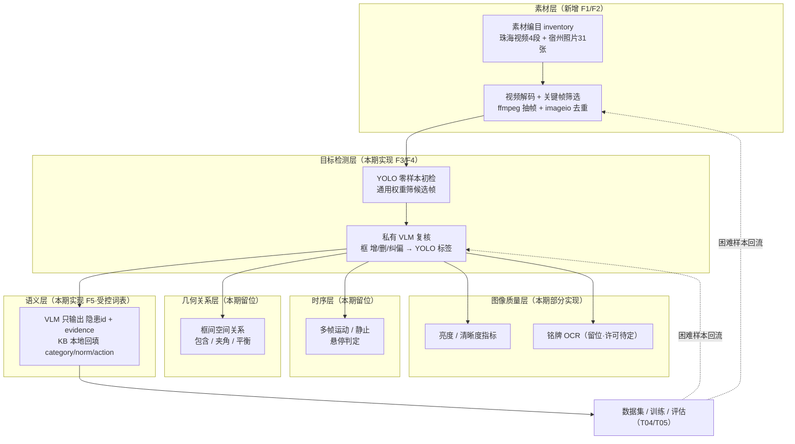
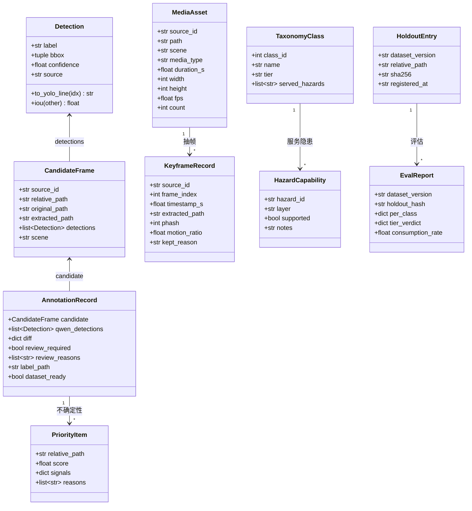
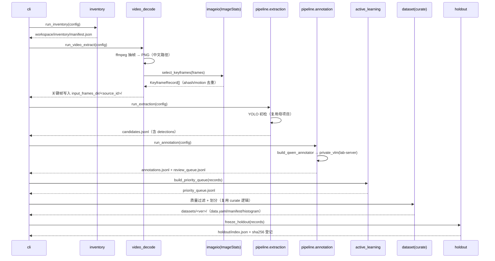
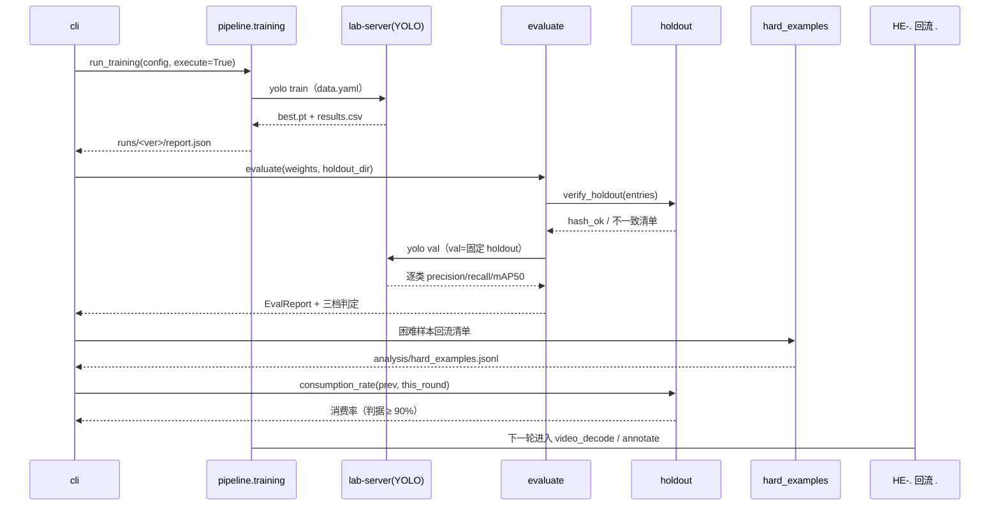

# 架构设计：工业隐患单场景（吊装）YOLO 冷启动标注与训练

- 文档类型：系统架构设计 + 任务分解
- 日期：2026-09-20
- 架构师：高见远
- 项目名（snake_case）：`industrial_hazard_coldstart`
- 唯一需求依据：`deliverables/REQUIREMENTS-需求分析-20260920.md`（v1.2）
- 单文件交付，不建子目录

> 设计立场：`traffic_cv_closed_loop/` 已跑通、18 项测试全绿。本设计是**增量**——把母项目当**库**用（import 复用），
> 把本期真正缺的能力（视频解码、编目、holdout、评估、分层）作为**新包**补上。母项目一行不改。

---

## 1. 设计目标与约束回顾

**一句话目标**：为「珠海吊装视频 4 段 + 宿州照片 31 张」从零产出可训练的吊装 YOLO 数据集，并在 `lab-server` 上跑通一轮
「训练 → 固定 holdout 评估 → 困难样本回流」闭环，交付吊装场景检测权重。

**必须满足的硬约束**（引自任务书第三节，设计不得违反）：

1. `traffic_cv_closed_loop/` **一行不改**，新能力只能以新增文件 / 新配置承载。
2. **零新增 Python 第三方依赖**，只用标准库；`pyproject.toml` 的 `dependencies = []` 保持。
3. 现有 **18 项测试必须保持全绿**（新包不得破坏 `tests/` 现有导入路径）。
4. **素材不出网**：真实素材解析途径仅限本机 YOLO、`lab-server` 的 YOLO、实验室私有 VLM 端点；
   禁止公有云 / 第三方多模态 API；配置层必须有端点护栏。
5. **中文路径全链路支持**（素材、输出、配置路径均含中文）。
6. **本机只做小规模验证**（单测 / 冒烟 / 小样本）；全量训练上 `lab-server`（工作区仅 `/data/users/lyk`，RTX 4090D）。
7. **许可**：Ultralytics 为 AGPL-3.0；引入 SAM 类 / 开放词汇检测须先确认许可。
8. **开源资源与自有资源不得混放**（两棵子树硬隔离）。

**三条新发现如何塑造本设计**（核心）：

- **发现一（9 条隐患靠框做不了）** → 必须在架构上**分层**：目标检测层 / 几何关系层 / 时序层 / 语义层 / 图像质量层。
  不允许把这些塞给一个 YOLO 权重。见第 2 节。
- **发现二（VLM 仅从 `lab-server` 可达；稳态 10.7 秒/帧）** → **部署拓扑约束**：VLM 调用必须从 `lab-server` 发起。
  且端点 `119.23.145.227:38091` 是**公网 IP**（非内网），`local_only` 会拒绝，必须用 `allowlist` 显式白名单。见第 7 节。
- **发现三（类别收窄为吊装 12 类）** → 类别体系、S1 映射、class_id 顺序**写死**在 `taxonomy.py`。见第 10 节。

---

## 2. 架构分层（本次设计的核心）

### 2.1 分层与数据流

### 2.2 每层职责（输入 / 输出 / 手段 / 隐患归属）

1. **素材层**（本期实现）
   - 输入：`D:\WorkPlace\industrial-data\` 下原始视频与照片（只做元数据登记 + 抽帧，不解析内容语义）。
   - 输出：`manifest.json`（素材清单）+ `candidates.jsonl`（候选帧清单）+ 关键帧 PNG。
   - 手段：ffmpeg（subprocess）+ 复用 `traffic_cv_closed_loop/imageio.py` 的 `ahash` / `hamming` / `motion_ratio` 去重。
   - 隐患归属：无（只做入库）。

2. **目标检测层**（本期实现，**交付物层**）
   - 输入：候选关键帧 PNG、通用预训练权重。
   - 输出：标准 YOLO 标签（`class x_center y_center w h`）+ 复核队列。
   - 手段：复用 `pipeline/extraction.run_extraction`（YOLO 初检）+ `pipeline/annotation.run_annotation`（VLM 复核）。
   - 隐患归属：**「物体在哪里」**——覆盖 27 条中 **18 条**（27 − 9 条框做不了的）。

3. **语义层**（本期实现，**降级为内部手段，非交付物**）
   - 输入：候选帧 + 知识库 S1（吊装 27 条）+ S3（通用 1 条）。
   - 输出：模型输出的 `隐患id + evidence`，本地回填 `category / norm_reference / action`（落 `workspace/hazards/report.json`）。
   - 手段：复用 `adapters/qwen.PrivateVlmAnnotator.annotate_combined` 的 `hazard_report` 字段 + 本地 KB 回填。
   - 隐患归属：**约束模型输出空间、降低幻觉、提升框质量**——用受控词表（隐患 id 而非自由文本）服务全部 27 条。

4. **几何关系层**（**本期只留位置**）
   - 输入：检测框（`Detection` 列表）。
   - 输出：`RelationFinding`（关系结论 + 置信 + 依据框）。
   - 手段：纯 Python 几何（包含关系、垂直夹角、重心偏移），零依赖。
   - 隐患归属：D-2-1 吊架不平衡、D-2-4 托架捆绑不牢、D-4-3 歪拉斜吊、D-5-3 人员站吊物下方（4 条）。
   - **本期范围**：只实现纯几何原语 + 单测，**不接入交付指标**（框是输入不是结论，需人工/规则确认）。

5. **时序层**（**本期只留位置**）
   - 输入：同一 `source_id` 的相邻候选帧。
   - 输出：`TemporalFinding`（静止 / 运动 / 悬停时长）。
   - 手段：复用 `imageio.motion_ratio` 跨帧比较。
   - 隐患归属：D-3-6 吊物悬停、D-3-7 相邻龙门吊同时运行（2 条）。

6. **图像质量层**（**本期部分实现**）
   - 输入：单帧像素。
   - 输出：亮度 / 清晰度指标 + 判定。
   - 手段：复用 `imageio.histogram16` 算亮度分布（D-4-1 照明不足，**本期可实现**）。
   - OCR（D-1-6 未标识承重重量）与超分辨（D-1-4 吊带割口）：**本期留位不实现**——需额外模型，许可待确认（约束 7）。

### 2.3 为什么这样分层

- **不把 9 条硬塞给 YOLO**：框只回答「物体在哪里」，回答不了「状态对不对」。分层让每一类隐患归到有能力回答它的层。
- **本期实现 1/2/3 层 + 图像质量的一部分**，因为它们能被现有母项目能力 + 标准库直接承载，零新增依赖。
- **几何/时序/OCR 层留位不实现**：它们要么需要框之外的信息（时序、文字、细节），要么需要引入新模型（违反零依赖 / 许可未定）。
  留出**结构位置**（`layers/` 子包 + 数据结构 + 单测），使将来接入时无需重构，只需填充实现。

---
## 3. 复用 vs 新增的边界

### 3.1 直接复用（**已逐行读代码确认**，均以 import 方式复用，母项目一行不改）

1. `config.py`：`ProjectConfig.load()`、`endpoint_allowed()`、`is_local_endpoint_host()`、`endpoint_host_of()`、
   `endpoint_port_of()`、`VideoConfig` / `KeyframeConfig` / `KnowledgeConfig`；`label_to_index` 属性（**class_id 顺序即 `labels` 数组顺序**）。
2. `models.py`：`Detection`（含 `to_yolo_line` / `iou` / `normalize_bbox`）、`CandidateFrame`、`AnnotationRecord`、`normalize_bbox`。
3. `io_utils.py`：`ensure_dir / read_json / write_json / read_jsonl / write_jsonl / read_text / write_text /
   copy_file / iter_image_files / timestamp_token / stem_sidecar / image_mime_type / SUPPORTED_IMAGE_SUFFIXES`。
4. `imageio.py`：`ahash / hamming / histogram16 / histogram_delta / motion_ratio / block_downscale /
   ImageStats / load_image / encode_png / image_to_png_bytes`（纯标准库，关键帧去重与 PNG 转码的主力）。
5. `dataset_media.py`：`materialize_dataset_image / dataset_image_relative_path / ULTRALYTICS_IMAGE_SUFFIXES`（保证 Ultralytics 可读扩展名）。
6. `adapters/yolo.py`：`SidecarDetector / UltralyticsDetector / MockTrainer / UltralyticsTrainer / build_detector / build_trainer`。
7. `adapters/qwen.py`：`MockQwenAnnotator / OpenAICompatibleQwenAnnotator / PrivateVlmAnnotator /
   ThinkingJsonParser / build_qwen_annotator`（含图片魔数校验、多图、thinking-aware JSON 解析）。
8. `pipeline/extraction.py`：`run_extraction` —— **仅处理图片目录**，按 `frame_step` 抽样 + YOLO 初检 → `candidates.jsonl`。
9. `pipeline/annotation.py`：`run_annotation` + `_compare_detections`（两段式核心：差异比对 + 复核队列 + 标签落盘）。
10. `pipeline/training.py`：`run_training` + `_split_counts` + `_build_dataset_yaml` + `_build_next_cycle_tasks`。
11. `prompting.py`：`render_annotation_prompt`（模板占位符 `{scene}/{labels}/{candidate_path}/{prior_detections}`）。
12. `diagnostics.py`：`build_doctor_report / probe_qwen_service / probe_detector`。
13. `scripts/curate_video_batch.py`：`frame_quality / keep_record / split_counts / build_dataset_yaml`（质量过滤 + 划分的现成实现）。

### 3.2 ⚠️ 关键缺口（读代码确认母项目**没有**，必须新建）

1. **视频解码 + 关键帧筛选的编排**：`run_extraction` 只读 `input_frames_dir` 图片目录，**从不调用 ffmpeg**；
   `VideoConfig` / `KeyframeConfig` 字段被加载与校验，但**没有任何代码消费它们**。这是 F2 的真实缺口。
2. **素材编目（F1）**：无扫描媒体目录、登记时长/分辨率/帧率的能力。
3. **主动学习 / 不确定性采样（F6）**：无优先级队列。
4. **固定 holdout 冻结 + 内容哈希登记（需求 7.4/7.5）**：`run_training` 每次用 `timestamp_token()` 版本 + 随机划分，无「逐字节不变」的 holdout。
5. **逐类评估 + 三档判定 + 困难样本消费率（F10 / 7.5.5）**：`run_training` 只写 `hard_examples.jsonl` 与 `next_cycle_tasks.md`，
   没有在固定 holdout 上的评估、没有逐类指标、没有消费率校验。
6. **几何层 / 时序层 / 图像质量层**（发现一的分层）。
7. **12 类类别体系 + S1 映射 + 能力分层表**（taxonomy）。

### 3.3 新代码放在哪里

- 新建顶层包 **`industrial_hazard_coldstart/`**（与 `traffic_cv_closed_loop/` 平级），**import 复用**母项目，不复制、不改动。
- 新建**自有资源子树 `own/`**（hoist 场景配置 + prompt + workspace）与**开源资源子树 `open/`**（权重来源与许可记录），二者硬隔离。
- 新测试放 `tests/`（新增文件，不改动现有 3 个测试文件）。

### 3.4 为什么这样切分能同时满足两条硬约束

- **母项目一行不改**：复用完全通过 `import traffic_cv_closed_loop...` 完成——它本就是可导入的包（`pyproject.toml` 已声明 `traffic-cv-closed-loop`，
  `tests/` 直接从仓库根导入）。新增能力全部落在新包里，母项目文件字节不变。
- **零新增依赖**：新包只 import（a）Python 标准库、（b）母项目、（c）自身子模块。ffmpeg 通过 `subprocess` 调**外部二进制**（不是 Python 依赖），
  与母项目 `adapters/yolo.py` 调 `yolo` 二进制的方式一致。`dependencies = []` 保持。

---

## 4. 文件列表及相对路径

**新增：新代码包 `industrial_hazard_coldstart/`**
1. `industrial_hazard_coldstart/__init__.py` —— 包版本与导出。
2. `industrial_hazard_coldstart/__main__.py` —— `python -m industrial_hazard_coldstart` 入口。
3. `industrial_hazard_coldstart/cli.py` —— 子命令：`inventory / extract-video / extract / annotate / prioritize / curate / freeze-holdout / train / evaluate / doctor`。
4. `industrial_hazard_coldstart/taxonomy.py` —— **12 类体系 + class_id 顺序 + 场景枚举 + S1 映射 + 隐患能力分层表 + 尺寸分档**（共享契约的单一真源）。
5. `industrial_hazard_coldstart/models.py` —— 新数据结构（`MediaAsset / KeyframeRecord / TaxonomyClass / HazardCapability / HoldoutEntry / PriorityItem / EvalReport / RelationFinding / TemporalFinding`）；**复用**母项目的 `Detection / CandidateFrame / AnnotationRecord`。
6. `industrial_hazard_coldstart/inventory.py` —— 素材编目（F1），产出 `manifest.json`。
7. `industrial_hazard_coldstart/video_decode.py` —— ffmpeg 抽帧 + 关键帧去重（F2），产出关键帧到 `input_frames_dir`。
8. `industrial_hazard_coldstart/active_learning.py` —— 不确定性采样（F6），产出 `priority_queue.jsonl`。
9. `industrial_hazard_coldstart/dataset.py` —— 质量过滤 + 版本化数据集（F8），复用 `curate_video_batch` 的函数。
10. `industrial_hazard_coldstart/holdout.py` —— 固定 holdout 冻结 + sha256 登记 + 逐字节校验（7.4）。
11. `industrial_hazard_coldstart/evaluate.py` —— 固定 holdout 逐类评估 + 三档判定 + 困难样本 + 消费率（F10 / 7.5）。
12. `industrial_hazard_coldstart/doctor.py` —— 探活扩展：ffmpeg / VLM（经 lab-server）/ 端点护栏 / holdout 完整性。
13. `industrial_hazard_coldstart/layers/__init__.py` —— 分层子包。
14. `industrial_hazard_coldstart/layers/geometry.py` —— 几何关系层原语（D-2-1 / D-2-4 / D-4-3 / D-5-3）。
15. `industrial_hazard_coldstart/layers/temporal.py` —— 时序层（D-3-6 / D-3-7）。
16. `industrial_hazard_coldstart/layers/semantic.py` —— 图像质量（D-4-1）+ OCR 占位（D-1-6）+ 超分辨占位（D-1-4）。
17. `industrial_hazard_coldstart/orchestrator.py` —— 串联各阶段 `run_cycle(config, stage)`。

**新增：自有资源子树 `own/`**
18. `own/hoist_project/config/project.hoist.json` —— hoist 场景项目配置（12 类 labels、private_vlm、endpoint allowlist）。
19. `own/hoist_project/assets/prompts/hoist_zh.md` —— 吊装中文标注提示词（含 KB S1 注入与受控词表要求）。
20. `own/hoist_project/README.md` —— 该子树说明（素材来源、运行顺序）。

**新增：开源资源子树 `open/`**
21. `open/README.md` —— 开源资源清单与硬隔离说明。
22. `open/licenses.md` —— Ultralytics AGPL-3.0 说明与权重来源记录（约束 7）。
**新增：测试**
23. `tests/test_taxonomy.py` —— 12 类 / class_id 唯一 / S1 映射完整性 / 能力分层表覆盖 27 条。
24. `tests/test_video_decode.py` —— 关键帧去重（合成图）、中文路径、ffmpeg 缺失降级。
25. `tests/test_holdout.py` —— holdout 逐字节不变 + sha256 校验。
26. `tests/test_layers.py` —— 几何 / 时序 / 图像质量原语单测。

**新增：脚本**
27. `scripts/run_hoist_cycle.ps1` —— 本机小样本冒烟入口（Windows）。
28. `scripts/run_hoist_cycle.sh` —— `lab-server` 全量入口（Linux）。
**修改（最小、非受保护文件）**
29. `.gitignore` —— 追加 `own/*/input/`、`own/*/workspace/`、`open/weights/` 等规则（母项目目录不在改动范围）。
30. `pyproject.toml`（**可选**）—— 追加 `[project.scripts]` 一条 `industrial-hazard-coldstart`；若不加，用 `python -m` 亦可。

> 说明：第 29、30 项**不触及 `traffic_cv_closed_loop/`**，符合硬约束 1。`dependencies` 保持 `[]`。

---

## 5. 核心数据结构与接口

### 5.1 类图

### 5.2 关键函数签名

1. `inventory.scan_media(root: Path, scene: str) -> list[MediaAsset]`；`inventory.run_inventory(config) -> dict`。
2. `video_decode.probe_video(path: Path, ffmpeg_binary: str) -> dict`（用 ffprobe 取时长/分辨率/帧率）。
3. `video_decode.sample_frames(video: Path, out_dir: Path, sample_fps: float, ffmpeg_binary: str) -> list[Path]`。
4. `video_decode.select_keyframes(frames: list[Path], kf: KeyframeConfig, stats: ImageStats) -> list[KeyframeRecord]`。
5. `video_decode.run_video_extract(config) -> dict`（把保留下来的关键帧写入 `config.input_frames_dir/<source_id>/`）。
6. `active_learning.score_uncertainty(record: AnnotationRecord) -> PriorityItem`；`build_priority_queue(records, top_k) -> list[PriorityItem]`。
7. `holdout.freeze_holdout(records, ratio: float, seed: int, out_dir: Path) -> list[HoldoutEntry]`；
   `holdout.verify_holdout(entries: list[HoldoutEntry]) -> dict`（返回 `hash_ok` 与不一致清单）。
8. `evaluate.evaluate(weights: Path, holdout_dir: Path, config) -> EvalReport`；
   `evaluate.tier_verdict(per_class: dict, taxonomy) -> dict`；`evaluate.consumption_rate(prev_hard: list, this_round: list) -> float`。
9. `layers.geometry.contains(outer: Detection, inner: Detection) -> bool`；`vertical_angle_deg(load: Detection, hook: Detection) -> float`；
   `find_person_under_load(dets) -> list[RelationFinding]`。
10. `layers.temporal.detect_suspended_load(frames: list[CandidateFrame], kf) -> list[TemporalFinding]`。
11. `layers.semantic.brightness_score(image: Path) -> float`（复用 `imageio.histogram16`）；
    `ocr_weight_marking(image: Path) -> None`（占位：`raise NotImplementedError`，附许可说明）。
12. `orchestrator.run_cycle(config, stage: str) -> dict`。

---

## 6. 程序调用流程

### 6.1 流程①：素材入库到数据集产出

### 6.2 流程②：训练到评估到困难样本回流

---

## 7. 部署拓扑（因发现二而必须写）

### 7.1 两侧分工

1. **本机（Windows）**：素材编目、视频解码抽帧、关键帧筛选、单测、mock 端到端、小样本冒烟。
   ffmpeg 不在 PATH，须显式指定（`D:\WorkPlace\tools\ffmpeg\bin`，实测 9.0.1）。**不跑全量、不调 VLM**。
2. **`lab-server`（Linux，工作区 `/data/users/lyk`，RTX 4090D）**：全量标注跑批、**VLM 调用**、全量 YOLO 训练、固定 holdout 评估。

### 7.2 VLM 调用从哪发起（关键）

- **从 `lab-server` 发起**。实测：本机到端点 TCP 15 秒超时 / 代理 502；`lab-server` 到端点 HTTP 403（在线且强制鉴权）。
- 端点 URL：`http://119.23.145.227:38091/api/generate`（Ollama-native），token 从 `/data/users/lyk/.secrets/lab_vlm_token.env` 读取。
- **⚠️ 护栏要点**：`119.23.145.227` 属**公网 IP 段**，`is_local_endpoint_host()` 返回 `False`，因此
  `local_only` 会**直接拒绝**该端点。必须在配置里显式白名单：
  `inference.endpoint_policy.mode = "allowlist"`，`allowlist = ["119.23.145.227:38091"]`。
  这样既放行实验室私有端点，又阻断「改个 base_url 就把素材发到别处」。

### 7.3 数据如何流动，为什么不违反「素材不出网」

1. **本机 → `lab-server`**：只传**抽出的关键帧 PNG**（不是原始视频、不是原始照片），体积小、泄露面小。
   传输用 `rsync/scp`（人工或脚本），**不进 git**（`.gitignore` 已排除 `*.mp4`、`workspace/` 等）。
2. **`lab-server` 内部**：关键帧 → 私有 VLM 端点（实验室私有服务，非第三方云 API）→ 标签。
3. **`lab-server` → 本机**：回传 `labels/`、`annotations.jsonl`、`metrics.json`、`report.json`（无原始素材）。
4. **不违反「素材不出网」的理由**：端点是实验室私有 VLM，被 `allowlist` 显式声明，**不是**公有云 / 第三方多模态 API；
   且护栏保证除该端点外任何公网主机都收不到帧。原始视频/照片始终留在内网。

### 7.4 开源 / 自有子树隔离

- 仓库侧：`own/`（自有：hoist 配置、prompt、workspace）与 `open/`（开源：权重来源、许可记录）两棵子树硬隔离。
- `lab-server` 侧：`/data/users/lyk/own` 与 `/data/users/lyk/open` 同样隔离；下载的开源权重只落 `open/`，真实素材派生数据只落 `own/`。

---

## 8. 任务列表（5 大任务 + 子任务，按依赖排序）

> 结构说明：顶层遵守「不超过 5 个任务」的硬上限；每个顶层任务再拆为**可被工程师一次实现完并自测**的子任务。
> 每条子任务含：涉及文件 / 依赖 / 完成判据。

### T01 项目基础设施与共享契约（P0，无前置）

- **T01.1 新包骨架与入口** —— 文件：`industrial_hazard_coldstart/__init__.py`、`__main__.py`、`cli.py`（子命令骨架）。
  依赖：无。判据：`python -m industrial_hazard_coldstart --help` 可跑；`import industrial_hazard_coldstart` 成功；`tests/` 现有 18 项仍全绿。
- **T01.2 类别体系与共享契约** —— 文件：`taxonomy.py`。依赖：无。
  判据：12 类 class_id 唯一且顺序固定；S1 的 27 条全部映射到类或能力层；能力分层表覆盖 9 条「框做不了」的隐患。
- **T01.3 新数据结构** —— 文件：`models.py`（9 个新 dataclass，复用母项目 `Detection/CandidateFrame/AnnotationRecord`）。依赖：T01.2。
  判据：`tests/test_taxonomy.py` 通过；每个结构有 `from_dict/to_dict`。
- **T01.4 hoist 配置与子树** —— 文件：`own/hoist_project/config/project.hoist.json`、`own/hoist_project/assets/prompts/hoist_zh.md`、
  `own/hoist_project/README.md`、`open/README.md`、`open/licenses.md`、`.gitignore`（追加规则）。
  依赖：T01.2。判据：`ProjectConfig.load()` 能加载该配置且 `labels` 为 12 类、`endpoint_policy.mode=allowlist`；护栏对非白名单公网端点报错。
- **T01.5 探活与护栏扩展** —— 文件：`doctor.py`、`scripts/run_hoist_cycle.ps1`、`scripts/run_hoist_cycle.sh`。依赖：T01.1、T01.4。
  判据：`doctor` 报告含 ffmpeg / VLM（经 lab-server）/ 端点护栏 / holdout 完整性四项。

### T02 素材编目 + 视频解码与关键帧筛选（P0，依赖 T01）

- **T02.1 素材编目（F1）** —— 文件：`inventory.py`。依赖：T01.3。
  判据：对 `industrial-data/` 产出 `manifest.json`，含 `source_id/path/scene/media_type/duration/resolution/fps/count`；中文路径不报错。
- **T02.2 视频解码与关键帧筛选（F2）** —— 文件：`video_decode.py`。依赖：T01.3、T02.1。
  判据：ffmpeg 抽帧 → PNG；`select_keyframes` 用 `imageio` 去重；`ffmpeg` 缺失时给出明确降级错误。
- **T02.3 接入母项目初检** —— 文件：`orchestrator.py`（extract-video + extract 两阶段串联）。依赖：T02.2。
  判据：关键帧写入 `input_frames_dir` 后 `run_extraction` 产出 `candidates.jsonl`（`CandidateFrame` 兼容）。
- **T02.4 单测** —— 文件：`tests/test_video_decode.py`。依赖：T02.2、T02.3。
  判据：合成图去重、中文路径、ffmpeg 缺失三条用例通过。

### T03 两段式标注 + 主动学习 + 语义约束（P0，依赖 T02）

- **T03.1 吊装提示词与知识库注入** —— 文件：`own/hoist_project/assets/prompts/hoist_zh.md`（含 `{scene}/{labels}/{candidate_path}/{prior_detections}` 占位符）。
  依赖：T01.4。判据：`render_annotation_prompt` 渲染成功；提示词含受控词表（隐患 id）要求。
- **T03.2 复用两段式标注** —— 文件：`orchestrator.py`（annotate 阶段）。依赖：T03.1、T02.3。
  判据：mock 路径端到端产出 `labels/` + `annotations.jsonl` + `review_queue.jsonl`。
- **T03.3 语义层：受控词表 + KB 回填** —— 文件：`orchestrator.py`（hazard 回填）、复用 `PrivateVlmAnnotator.annotate_combined`。依赖：T03.2。
  判据：`workspace/hazards/report.json` 含 `hazard_id + evidence`，`category/norm_reference/action` 由本地 KB 回填。
- **T03.4 主动学习（F6）** —— 文件：`active_learning.py`。依赖：T03.2。
  判据：产出 `priority_queue.jsonl`，按低置信度 / 差异计数排序，含 `score` 与 `signals`。
- **T03.5 单测** —— 文件：`tests/test_annotation_flow.py`。依赖：T03.2、T03.3、T03.4。
  判据：mock 端到端 + 优先级排序用例通过。

### T04 数据集构建 + holdout 冻结 + 训练（P0，依赖 T03）

- **T04.1 质量过滤与版本化数据集（F8）** —— 文件：`dataset.py`（复用 `curate_video_batch` 的 `frame_quality/keep_record/split_counts/build_dataset_yaml` + `materialize_dataset_image`）。
  依赖：T03.2。判据：产出 `datasets/<ver>/`（`data.yaml/manifest.json/class_histogram.json/quality_report.json`）。
- **T04.2 固定 holdout 冻结（7.4）** —— 文件：`holdout.py`。依赖：T04.1。
  判据：`holdout/index.json` 登记每帧 sha256；`verify_holdout` 能检出被改动的一帧。
- **T04.3 训练编排（F9）** —— 文件：`orchestrator.py`（train 阶段，复用 `run_training` / `UltralyticsTrainer`）。依赖：T04.1、T04.2。
  判据：`lab-server` 上 `--execute-trainer` 产出 `best.pt` + `results.csv` + `report.json`。
- **T04.4 单测** —— 文件：`tests/test_holdout.py`。依赖：T04.2。判据：逐字节不变 + 篡改检出两条用例通过。

### T05 评估回流 + 分层能力（P0/P1，依赖 T04）

- **T05.1 固定 holdout 逐类评估（F10）** —— 文件：`evaluate.py`。依赖：T04.2、T04.3。
  判据：在固定 holdout 上产出逐类 `precision/recall/mAP50` + 误检率；按 A/B/C 三档给判定；holdout 样本为 0 的类判为「无效」。
- **T05.2 困难样本回流与消费率（7.5.5）** —— 文件：`evaluate.py`（`hard_examples` + `consumption_rate`）。依赖：T05.1。
  判据：`analysis/hard_examples.jsonl` 产出；下一轮消费率可计算并可与 90% 判据比较。
- **T05.3 几何关系层** —— 文件：`layers/geometry.py`、`tests/test_layers.py`。依赖：T01.3。
  判据：`contains` / `vertical_angle_deg` 单测通过；对 D-5-3、D-4-3 给出 `RelationFinding`（**不接入交付指标**）。
- **T05.4 时序层** —— 文件：`layers/temporal.py`。依赖：T01.3。判据：对相邻帧给出静止/运动判定（D-3-6）。
- **T05.5 图像质量层 + OCR 占位** —— 文件：`layers/semantic.py`。依赖：T01.3。
  判据：`brightness_score` 复用 `imageio` 单测通过（D-4-1）；`ocr_weight_marking` 抛 `NotImplementedError` 并附许可说明（D-1-6）。

---

## 9. 依赖包列表

**新增第三方 Python 依赖：零。**

1. 新包只使用：Python 标准库（`json / subprocess / pathlib / dataclasses / hashlib / csv / random / urllib` 等）、
   母项目 `traffic_cv_closed_loop`、自身子模块。
2. ffmpeg / ffprobe 通过 `subprocess` 调用**外部二进制**，与母项目调用 `yolo` 二进制的方式一致，不构成 Python 依赖。
3. Ultralytics（AGPL-3.0）仍为 `pyproject.toml` 的 `optional-dependencies.production`，仅在 `lab-server` 训练时使用，不进默认依赖。
4. `pyproject.toml` 的 `dependencies = []` **保持不变**。

---

## 10. 共享知识（跨文件约定，写死）

1. **12 类 class_id 顺序（`labels` 数组顺序即 class_id，不可重排）**：
   0 `person`、1 `helmet`、2 `vest`、3 `hook`、4 `rigging`、5 `overhead_crane`、6 `spreader`、
   7 `balance_beam`、8 `load`、9 `pallet`、10 `hopper`、11 `ebike`。
2. **明确排除（属高处作业，不进任何配置）**：`ladder`、`scaffold`、`guardrail`、`harness`。
3. **场景枚举**：`hoist`（吊装，本期）/ `height`（高处，**留位不实现**）；本期 `scene` 恒为 `hoist`。
4. **尺寸分档（A/B/C，供验收）**：
   - A 档（源分辨率下短边 ≥ 100px）：`overhead_crane`、`load`、`person`；判据 mAP50 ≥ 0.70、召回 ≥ 0.80。
   - B 档（短边 32–100px）：`hook`、`rigging`、`spreader`、`balance_beam`、`pallet`、`hopper`、`ebike`；判据 mAP50 ≥ 0.50、召回 ≥ 0.65。
   - C 档（短边 < 32px）：`helmet`、`vest`；判据 mAP50 ≥ 0.35、召回 ≥ 0.55，并**显式标注像素下限风险**。
   - 注：需求 7.3 的分档原含 `ladder/scaffold`（已排除），此处按 12 类重新分档，理由=按目标像素尺寸归并。
5. **能力分层表（9 条框做不了的隐患）**：
   - 时序层：D-3-6、D-3-7；几何层：D-2-1、D-2-4、D-4-3、D-5-3；
   - 语义/OCR：D-1-6；超分辨：D-1-4；图像质量：D-4-1。其余 18 条归目标检测层。
6. **目录约定（相对 project_dir）**：
   `workspace/inventory/manifest.json`；`workspace/extracted/frames/` + `candidates.jsonl` + `summary.json`；
   `workspace/review/labels/` + `raw_responses/` + `annotations.jsonl` + `review_queue.jsonl` + `priority_queue.jsonl`；
   `workspace/hazards/report.json`；`workspace/datasets/<version>/` + `holdout/index.json`；
   `workspace/runs/<version>/`；`workspace/eval/<version>/`；`workspace/analysis/hard_examples.jsonl` + `next_cycle_tasks.md`；
   `workspace/probes/`；`workspace/status/<stage>.json`。
7. **字段命名**：沿用母项目——素材/帧用 `source_id / relative_path / original_path / extracted_path / detections / scene / metadata`；
   检测用 `label / bbox / confidence / source / notes`（`bbox` 为归一化 xyxy）。
8. **错误码 / 日志**：沿用母项目风格——每个阶段写 `workspace/status/<stage>.json` 摘要；异常用 `ValueError/RuntimeError` + 中文可读消息；
   护栏拒绝信息引用 `endpoint_allowed` 的 `reason`。
9. **端点护栏**：`inference.endpoint_policy.mode = "allowlist"`，`allowlist = ["119.23.145.227:38091"]`（公网 IP 必须显式声明）。
10. **holdout 铁律**：自首次冻结起**逐字节不变**，以 sha256 登记；train/val 指标不得对外作为能力声明。
11. **零依赖 / 中文路径 / 母项目一行不改**：三条贯穿全部文件的硬约定。

---

## 11. 待明确事项

1. **A/B/C 三档按 12 类重新分档**是否与甲方口径一致（需求 7.3 原含已排除的 `ladder/scaffold`）。
2. **VLM 并发 / 配额**：实测仅串行 3 次；并发上限未知，影响标注跑批时长。
3. **人工复核预算**：决定复核队列规模上限与主动学习阈值松紧。
4. **几何 / 时序层是否本期必须**：当前定位为「留位 + 单测」，不接入交付指标；若甲方要求隐患结论则需升级为必达。
5. **ffprobe 在 `lab-server` 是否可用**：编目与视频解码依赖 ffmpeg/ffprobe，本机已确认路径，服务器侧未确认。
6. **holdout 冻结产物的存储位置**：`workspace/`（不入库）还是另存一份可复现清单入库，需确认。
7. **OCR / 超分辨的许可**：D-1-6、D-1-4 若将来接入，须先确认模型许可（约束 7）。
8. **`lab-server` 与端点的数据同步方式**：rsync/scp 的具体约定（谁发起、目标路径、幂等策略）待定。
