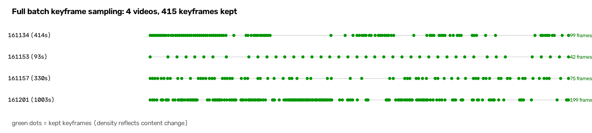
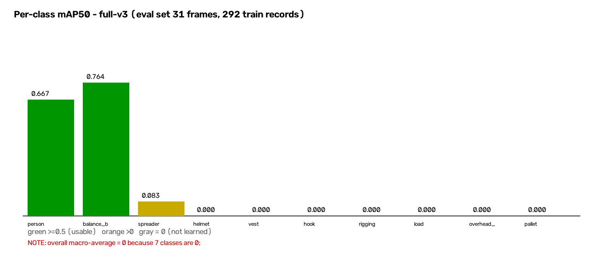

# 全量处理效果报告（分步骤 · 含图示与抽样）

> 生成时间：2026-09-23
> 数据来源：**珠海吊装视频全量批次**（4 段，含 `.qt`，合计 1908.53 秒 / 31.81 分钟）
> 环境：`lab-server`，工程 `/data/users/lyk/hoist_real/`
> 数据集版本：`full-v3`（292 条训练记录）
>
> **数据说明**：本报告所有统计均为**程序化计算**（文件元数据、标签文本、JSON 记录）。
> 图示由脚本生成（cv2 绘制）供人工查看，**助手未以任何方式读取画面内容**。

---

## 步骤总览

1. 素材编目（元数据登记）
2. 抽帧与关键帧筛选
3. YOLO 初检（筛候选）
4. VLM 复核标注（双通道）
5. 质量过滤与数据集构建
6. 固定 holdout 冻结 **+ 全量分层评估集**
7. 训练
8. 固定评估（双评估集对比）
9. **待人工审核清单**

---

## 步骤一 · 素材编目

1. 输入目录：`/data/users/lyk/industrial-data/`
2. 登记视频 **4 个**（3 个 `.mp4` + 1 个 `.qt`），合计 **1908.53 秒 = 31.81 分钟**
3. 分辨率统一 `960×540`，帧率 `30fps`
4. 跳过 **0 个**文件；闭合性校验 `登记 4 + 跳过 0 = 文件总数 4` ✓

---

## 步骤二 · 抽帧与关键帧筛选

**统计结果**：

1. 视频总时长：`1908.53` 秒
2. **保留关键帧：415 帧**
3. 分源明细：

| 源 | 时长 | 帧数 |
|---|---|---|
| `中海通20260508-161134` | 476.73s | 99 |
| `中海通20260508-161153` | 96.17s | 42 |
| `中海通20260508-161157` | 330.53s | 75 |
| `中海通20260508-161201`（`.qt`） | 1005.10s | 199 |

4. 输出尺寸：统一 `640×360`
5. 总体积：约 `132.9 MB`
6. 抽帧耗时：`13.9` 秒（4 段全量）
7. **产出速率：0.217 帧/秒视频**

**图示：全量抽帧时间轴**

（4 条时间轴对应 4 段视频，绿点为保留的关键帧。**点密度不均**说明筛选基于内容变化。）

**抽样：4 帧原图（未标注）**

---

## 步骤三 · YOLO 初检（筛候选）

**统计结果**：

1. 输入帧数：`415`
2. **选中候选：323 帧**（78%）
3. 跳过空帧：`92 帧`（22%）
4. **检出目标总数：657 个**
5. 检测器：`ultralytics`（真实 YOLO，权重 `yolo11n.pt`），置信度阈值 `0.25`
6. 耗时：约 3 分钟

---

## 步骤四 · VLM 复核标注（双通道）

**统计结果**：

1. 输入候选：`323 帧`
2. **完成标注：323 帧**（100%）
3. **VLM 检出目标总数：1553 个** —— **YOLO 的 2.4 倍**
4. 标注错误：`35 帧`（`annotation_error`）
5. 单帧耗时：稳态约 `176 秒/帧`
6. 总耗时：**约 15.9 小时**（10:17 → 次日 02:07）

**复核原因分布（322 帧）**：

1. `qwen_added_objects` —— **272 帧**（VLM 补检出目标）
2. `low_confidence` —— 131 帧
3. `qwen_removed_objects` —— 114 帧
4. `annotation_error` —— 35 帧
5. `bbox_adjusted` —— 26 帧
6. `hazard_report_missing` —— 2 帧

**框级差异**：

1. 总新增框：**1049 个**
2. 总删除框：153 个

**图示：YOLO 初检 vs VLM 复核（抽样 4 帧，按补检量取）**

（每帧上半为 YOLO 初检框【红】，下半为 VLM 复核框【绿】。）

**⚠️ 关键判读**：

1. **通用 YOLO 权重对本场景召回很低**（657 vs 1553），两段式标注中「初检筛候选」的**降本作用不明显**
2. **322 / 323 帧（99.7%）都需要人工审核** —— 几乎每一帧都因"VLM 新增目标"进入复核队列
3. **这说明"先用便宜模型筛掉简单帧"的设计假设在本场景不成立** —— 初检质量太低，筛不掉任何东西

---

## 步骤五 · 质量过滤与数据集构建

**统计结果**：

1. 输入记录：`323` 条
2. **通过：292 条 / 剔除：31 条**
3. 数据集划分：`train 173 / val 49 / holdout 9`（`full-v3`）
4. 版本号：`full-v3`（**非时间戳**，便于跨轮可比）

**类别分布（训练集，按框数）**：

| 类别 | 框数 |
|---|---|
| person | 281 |
| helmet | 223 |
| vest | 194 |
| overhead_crane | 81 |
| load | 54 |
| balance_beam | 42 |
| rigging | 39 |
| hook | 35 |
| spreader | 15 |
| pallet | 2 |

**⚠️ 两个结构性发现**：

**1. 类别覆盖 10 类，但极度不均衡**

`person` 是 `pallet` 的 **140 倍**。这直接决定了哪些类能学会、哪些学不会。

**2. 零样本类：`hopper`（料斗）、`ebike`（电瓶车）**

这两类在全部素材中**从未出现**。12 类清单源自知识库反向推导（"理论上可能出现的隐患载体"），实际素材只覆盖其中 10 类。零样本类在评估中判 `invalid`，不计入达标。

---

## 步骤六 · 固定 holdout 冻结 + 全量分层评估集

### 6.1 固定 holdout（跨轮可比，铁律）

1. 版本：`coldstart-v1`（第一批冻结，此后**逐字节不变**）
2. **冻结帧数：9 帧**
3. 聚合哈希：`ad91f906cd36a04dfd181bdf77e7ac70df8d9faf97b7613db895e0a5871bfc85`
4. **跨版本一致性已验证**：`coldstart-v1` / `full-v1` / `full-v2` / `full-v3` **哈希完全相同** ✓

### 6.2 全量分层评估集（本次新增）

**背景**：holdout 只有 9 帧，对全量批次统计意义不足。故另建一个**分层评估集**，用于全量批次的正式指标。

1. **帧数：31 帧**（从 323 条中分层抽样）
2. **覆盖：全部 10 类**
   `person 31 / helmet 23 / vest 22 / load 17 / hook 15 / rigging 15 / overhead_crane 15 / balance_beam 15 / spreader 6 / pallet 2`
3. **与 holdout 重叠：0 帧** ✓（两个评估集完全独立）
4. **抽样约束**：每类抽取上限 `min(该类帧数 × 30%, 15)` —— 保证训练集保留 ≥ 70%
5. 训练集保留率：**70% ~ 91%** ✓

**两个评估集的分工**：

1. **holdout（9 帧）** —— 跨轮可比（铁律要求冻结不变），用于观察"同一评估集上模型是否变好"
2. **全量评估集（31 帧）** —— 覆盖 10 类、样本量更足，用于**正式指标**

---

## 步骤七 · 训练

1. 训练器：`ultralytics`（真实训练）
2. 轮数：`50` epochs，设备 `GPU 0`（RTX 4090D）
3. 耗时：约 `10.6` 分钟
4. 产出：`best.pt` 5.5 MB

**训练曲线（mAP50）**：

| epoch | 1 | 5 | 10 | 20 | 30 | 40 | 50 |
|---|---|---|---|---|---|---|---|
| mAP50 | 0.0001 | 0.0434 | 0.0513 | 0.0906 | 0.0776 | 0.0934 | 0.0919 |

**判读**：曲线在 **epoch 20-40 之间已平缓** → **不是欠拟合**，是任务难度（类别多、样本不均衡）。

---

## 步骤八 · 固定评估（双评估集对比）

### 8.1 全量分层评估集（31 帧 / 10 类）—— 正式指标

| 类别 | Precision | Recall | mAP50 | gt |
|---|---|---|---|---|
| **balance_beam** | **0.923** | **0.800** | **0.764** | 15 |
| **person** | **0.780** | **0.736** | **0.667** | 53 |
| spreader | 0.500 | 0.167 | 0.083 | 6 |
| helmet | 0.000 | 0.000 | 0.000 | 32 |
| hook | 0.000 | 0.000 | 0.000 | 16 |
| load | 0.000 | 0.000 | 0.000 | 18 |
| overhead_crane | 0.000 | 0.000 | 0.000 | 15 |
| pallet | 0.000 | 0.000 | 0.000 | 2 |
| rigging | 0.000 | 0.000 | 0.000 | 16 |
| vest | 0.000 | 0.000 | 0.000 | 26 |

**overall（宏平均）：P=0.000 / R=0.000 / mAP50=0.000**

**三档判定：A / B / C 全部 `fail`**

**图示：逐类 mAP50**

### 8.2 ⚠️ `overall = 0` 是宏平均的假象

10 类里有 **7 类为 0**，**宏平均被拉到 0** —— 但：

1. `person` mAP50 = **0.667**（可用）
2. `balance_beam` mAP50 = **0.764**（可用）

**如果只看 overall，会误判为"完全没训出来"。** 这正是本项目坚持「**逐类报告、禁止只给平均值**」的原因。

### 8.3 固定 holdout（9 帧）—— 跨轮可比

| 版本 | person P | person R | person mAP50 |
|---|---|---|---|
| `full-v1` | 1.000 | 1.000 | 1.000 |
| `full-v2` | 0.102 | 1.000 | 0.203 |
| `full-v3` | 0.180 | 1.000 | 0.320 |

**⚠️ 关键判读**：

1. **Recall 恒为 1.000**（全部检出）
2. **Precision 在 0.10 ~ 1.00 之间剧烈波动**
3. **结论：9 帧评估集的指标不能用于交付判断** —— 样本量太小，单帧的检出/漏检会主导整个指标

**这正是新增全量评估集的直接理由。**

### 8.4 三档为何全部 fail（逐档拆解）

1. **A 档**（`overhead_crane` / `load` / `person`，要求 mAP50 ≥ 0.7）：
   `person` **0.667 接近但未达 0.7**；`load` / `overhead_crane` 为 0 → **fail**
2. **B 档**（`hook` / `rigging` / `spreader` / `balance_beam` / `pallet` / `hopper` / `ebike`，要求 ≥ 0.5）：
   `balance_beam` **0.764 达标**；但 `hook` / `rigging` / `pallet` 为 0 → **fail**
3. **C 档**（`helmet` / `vest`，要求 ≥ 0.35）：
   两者均为 0 → **fail**（并标注 `pixel_risk`）

**三档 fail 的构成不同**：A 档是"漏检/未学会"、B 档是"部分类未学会"、C 档是"物理不可分"。**混为一谈会掩盖差异。**

---

## 步骤九 · 待人工审核清单

**汇总**：

1. **待审核帧数：322 帧**（占候选的 **99.7%**）
2. 审核原因分布（可多因）：
   `qwen_added_objects` 272 / `low_confidence` 131 / `qwen_removed_objects` 114 /
   `annotation_error` 35 / `bbox_adjusted` 26 / `hazard_report_missing` 2

**图示：待审核帧抽样（4 帧，带 VLM 标注框与复核原因）**

**⚠️ 人工成本判读**：

**322/323 帧需要人工审核** —— 这意味着**两段式标注的"降本"目标在本场景未达成**。原因是通用 YOLO 初检召回过低（657 vs 1553），几乎每帧都有 VLM 新增目标。

**审核优先级建议**：

1. **`annotation_error` 的 35 帧** —— 标注失败，需排查原因（最优先）
2. **`qwen_added_objects` 且新增量大的帧** —— 需确认是"YOLO 漏检"还是"VLM 过检"
3. **`qwen_removed_objects` 的 114 帧** —— 确认 VLM 删除 YOLO 框是否正确
4. **`bbox_adjusted` 的 26 帧** —— 确认框位置调整是否合理
5. **`hazard_report_missing` 的 2 帧** —— 隐患报告缺失，需补跑

**完整清单**：见 `/data/users/lyk/hoist_real/workspace/review/review_queue.jsonl`（322 条，含每帧的 `review_reasons` 与 `diff`）。

---

## 附 · 隐患检出结果

### 双口径统计（帧级 / 事件级）

**抽帧是连续的，同一吊运事件会跨多帧被重复输出** —— 因此**必须同时给出两个口径**：

1. **帧级：197 条**（原始计数）
2. **事件级：134 个**（按 `source_id` 分组、时间间隔 ≤5 秒合并为 1 个事件；压缩比 1.5:1）
3. 总体风险等级：`critical`

**逐隐患对比**：

1. `D-5-3`（人员站在吊物下方）—— 帧级 **85**（43.1%）→ 事件级 **59**（**44.0%**）
2. `D-5-2`（未穿反光背心）—— 帧级 36（18.3%）→ 事件级 27（20.1%）
3. **`D-1-3`（吊链与硬质表面接触）—— 帧级 26（13.2%）→ 事件级 5（3.7%）**
4. `D-3-3`（大件未使用平衡梁）—— 帧级 25（12.7%）→ 事件级 19（14.2%）
5. `D-5-1`（未佩戴安全帽）—— 帧级 14（7.1%）→ 事件级 13（9.7%）
6. `D-3-6`（吊物悬停）—— 帧级 7（3.6%）→ 事件级 7（5.2%）
7. 其他 —— 帧级 4 → 事件级 4

**关键判读**：

1. **`D-5-3` 的占比在事件级下几乎不变**（43.1% → 44.0%）→ **占比结论成立**，不是重复计数造成的虚高
2. **`D-1-3` 才是重复最严重的**（26 → 5，**虚高 5 倍**）—— 典型例子：`161153` 段上**跨 22 帧**（t=14~70s）的连续吊链接触，被重复报了 22 次
3. **总数虚高 47%**（197 → 134）

### ⭐ 几何层独立验证（交叉验证）

本项目的几何层（`industrial_hazard_coldstart/layers/geometry.py`）**独立**计算了「人在吊物下方」：

1. VLM 文本判断（帧级）—— `D-5-3` **85** 条（读图后用文字判断）
2. VLM 文本判断（事件级）—— `D-5-3` **59** 个（同上 + 事件去重）
3. **几何层计算 —— `D-5-3` 32 条**（计算标注框的几何关系：脚点 / 净空比 / 坠落区）

**两套完全独立的方法在同一量级** → **`D-5-3` 的检出不是纯幻觉**，
几何层**独立确认了至少 32 处**。这比"只有 VLM 一个来源"强得多。

**几何层同时报出 `D-4-3`（歪拉斜吊）15 条，但该判据存在已知缺陷** ——
它基于 **2D 画面角度**、**未考虑透视与深度差**（吊物框大=离相机近、吊钩框小=离相机远时，
物理垂直也会呈大角度斜线）。**这 15 条已统一降级为 `needs_review`**，须人工确认。

**几何层判据修正记录**：原 `find_person_under_load` 用 `contains(load, person)` 判「人被吊物框包住」，
**只覆盖俯拍视角，地面视角永远判不出**（死代码）。已按 Singh & Seif 2026 射影解重写：
工人脚点 = 框底中心、净空比阈值 0.12、垂直门控 40px、梯形坠落区、三级输出。

### 回填正确性

`category` / `norm_reference` / `action` **全部来自本地知识库**（如 `GB/T 16271-2009`、`GB 6067.1-2010`），非模型生成。

### ⚠️ 能力范围外隐患（需人工确认）

1. **`hazards_needing_verification` = 92 条**（帧级，占 **47%**）
2. 分层：`geometry` 85 条 / `temporal` 7 条
3. 样例（`D-5-3`）：
   > 该隐患需「**几何关系推理**」能力（本期留位未实现），当前结论由 VLM 文本推断，**未经检测验证**。

**意义**：197 条隐患中 **92 条（47%）超出本期检测能力**。若不标记，甲方会误以为全部 197 条都是"系统检测出来的"。**这些条目须人工确认，不能直接采信。**

---

## 附 · 各步骤耗时汇总

| 步骤 | 耗时 |
|---|---|
| 素材编目 | 秒级 |
| 抽帧（415 帧） | 13.9 秒 |
| YOLO 初检（415 帧） | 约 3 分钟 |
| **VLM 标注（323 帧）** | **约 15.9 小时** |
| 数据集 + holdout | 秒级 |
| 训练（50 epochs） | 10.6 分钟 |
| 评估（双集） | 分钟级 |
| **合计** | **约 16.3 小时** |

**VLM 标注占全部耗时的 97.5%** —— 是整条链路的绝对瓶颈。

---

## 附 · 遗留问题与建议

### 问题 1 · `hook` / `rigging` 未学会（已做四项排查，逐一实测）

**排查过程与结论**：

1. **不是尺寸问题** —— 短边中位数 `hook 32px` / `rigging 64px`，**够大**
2. **不是标注混淆** —— 用 **IoU 验证**：56 对 `hook×rigging` 框，**IoU 中位 0.000**、均值 0.008，
   **IoU ≥ 0.5 的 0 对**。吊钩与索具在吊装现场**本来就物理共存**
   （吊钩挂在起重臂末端、吊带挂在吊钩下方），**高共现率是正常现象，不是混淆**。
   （对照组：`person×helmet` 已知包含关系中位 IoU 0.019）
3. **不是阈值问题** —— conf 从 0.25 扫到 **0.01**，这 7 类的 Recall **仍恒为 0**
   → 模型**根本不输出**这些类，不是"输出被阈值挡住"
4. **不是损失权重问题** —— 用 `cls=1.0` + `label_smoothing=0` 重训（10.7 分钟），
   **指标与 baseline 精确到 4 位小数相同**（权重 MD5 不同、`args.yaml` 确认参数已写入）
   → 因为 `cls` 控制**分类损失**（"检出的框属于哪一类"），
   而当前问题是**"根本检不出"**（目标性/定位问题），不是"分错类"

**修正后的归因**（按证据强度排序）：

1. **样本量不足** —— 训练集 `hook 35 帧` / `rigging 39 帧`（对比 `person` 281 帧）
2. **类内形态方差大** —— `balance_beam` 是固定长条横梁（**42 框即达 mAP50 0.764**）；
   而 `hook` 随吊装角度 / 远近**形态剧变**
3. **训练不稳定** —— `load` / `overhead_crane` 在 `full-v2` 是"高 P 低 R"，到 `full-v3` 变**全 0**

**建议**：这属于**数据侧限制**（样本量 + 目标形态），**非代码或标注质量问题**。
改善需**补采含吊钩/索具的素材**，或**提高源视频分辨率**（当前仅 960×540）。

### 问题 2 · `helmet` / `vest` 未学会（物理限制）

1. `helmet` 短边中位数仅 **10.8px**，**96% 的框短边 < 32px**
2. `vest` 短边中位数 **25.6px**，61% 的框 < 32px
3. 评估报告已自动标注 `pixel_risk`：
   > 960×540 上 helmet 约 **38.4×21.6 像素**，短边低于行业常用的 **32 像素下限**，该档指标天然偏低，**不得归因于「模型不行」**。

**建议**：若要检测 PPE 小目标，需**提高原始素材分辨率**（当前源视频仅 960×540），或采用切片推理（SAHI）。

### 问题 3 · 两段式标注的降本假设不成立

**现象**：322/323 帧（99.7%）需人工审核。

**原因**：通用 YOLO 权重对本场景召回过低（657 vs 1553），**初检筛不掉任何帧**。

**建议**：
1. **先训练一版场景专用初检模型**，再用于筛选（当前是"冷启动"，首轮无专用权重可用，属预期内的鸡生蛋问题）
2. 或**放宽"有目标才送 VLM"的策略**（当前 22% 空帧被跳过，已是最优）

### 问题 4 · 标注耗时 15.9 小时（瓶颈）

**原因**：单帧稳态 176 秒，主要来自**模型 thinking 输出**（响应体积 60-119 KB）。

**已验证不可行**：关 `enable_thinking` / 降 `max_tokens`（对比实验证明**无效**，模型是 thinking 专用版）。

**可行方向**：
1. 减小图片尺寸（`scale_width` 640 → 480/512）
2. 降低抽帧密度
3. 提高并发（需确认端点支持）

### 问题 5 · 宿州 31 张照片未跑

服务器上无该批素材，需从本机传输后另行跑批。

---

## 附 · 文件位置

1. 抽帧产物：`/data/users/lyk/hoist_real/input/frames/`（415 帧）
2. 标注记录：`/data/users/lyk/hoist_real/workspace/review/annotations.jsonl`（323 条）
3. 复核队列：`/data/users/lyk/hoist_real/workspace/review/review_queue.jsonl`（322 条）
4. 数据集：`/data/users/lyk/hoist_real/workspace/datasets/full-v3/`
5. 固定 holdout：`/data/users/lyk/hoist_real/workspace/holdout/`（9 帧）
6. **全量评估集**：`/data/users/lyk/hoist_real/workspace/eval_set/`（31 帧）
7. 隐患报告：`/data/users/lyk/hoist_real/workspace/hazards/report.json`（197 条）
8. 训练产物：`/data/users/lyk/hoist_real/workspace/runs/full-v3/`
9. 评估产物：`/data/users/lyk/hoist_real/workspace/eval/full-v3/`
