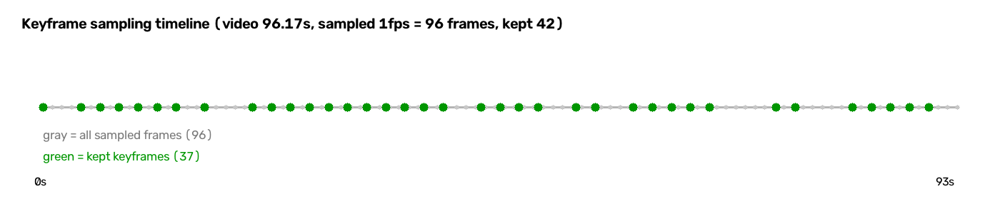

# 处理效果报告（分步骤 · 含图示与抽样）

> 生成时间：2026-09-22
> 数据来源：**珠海吊装视频试跑批次**（`中海通20260508-161153.mp4`，96.17 秒 / 960×540 / 30fps）
> 环境：`lab-server`，工程 `/data/users/lyk/hoist_real/`
> 状态：**试跑批次（42 帧）**；全量批次（415 帧 / 323 候选）正在标注中，完成后本报告会更新
>
> **数据说明**：本报告所有统计均为**程序化计算**（文件元数据、标签文本、JSON 记录）。
> 图示由脚本生成（cv2 绘制）供人工查看，**助手未以任何方式读取画面内容**。

---

## 步骤总览

1. 素材编目（元数据登记）
2. 抽帧与关键帧筛选
3. YOLO 初检（筛候选）
4. VLM 复核标注（双通道）
5. 质量过滤与数据集构建
6. 固定 holdout 冻结
7. 训练
8. 固定 holdout 评估
9. **待人工审核清单**

---

## 步骤一 · 素材编目

**做什么**：扫描素材目录，登记元数据（不解码画面）。

**结果**：

1. 输入目录：`/data/users/lyk/industrial-data/`
2. 登记视频 **4 个**（3 个 `.mp4` + 1 个 `.qt`），合计 **1908.53 秒 = 31.81 分钟**
3. 分辨率统一 `960×540`，帧率 `30fps`
4. 跳过 **0 个**文件（服务器上的素材目录干净）
5. 闭合性校验：`登记 4 + 跳过 0 = 文件总数 4` ✓

**本步骤无图示**（纯元数据登记，不产生视觉产物）。

---

## 步骤二 · 抽帧与关键帧筛选

**做什么**：ffmpeg 按 1fps 抽样 → 运动检测 + 感知哈希去重 → 保留关键帧。

**统计结果**：

1. 视频时长：`96.17` 秒
2. 抽样帧数：`96` 帧（1fps）
3. **保留关键帧：42 帧**（保留率 44%，去重率 56%）
4. 输出尺寸：统一 `640×360`（配置 `scale_width=640`）
5. 总体积：`12.7 MB`（平均 303 KB/帧）
6. 时间覆盖：`0.0s ~ 93.0s`（首尾均覆盖）
7. 相邻间隔：最小 2.0s / 最大 6.0s / **中位 2.0s**
8. 内容唯一性：**42 帧 42 个不同哈希，重复组 0**

**图示：抽帧时间轴**

（灰色点为 96 个抽样位置，绿色点为 42 个保留关键帧。间隔不均匀 = 按内容筛选，非机械抽帧。）

**抽样：4 帧原图（未标注）**

**判读要点**：

1. 间隔不均匀（2~6 秒）说明筛选确实基于**内容变化**，不是等间隔切分
2. `min_gap_seconds=2.0` 生效（没有比 2 秒更密的帧）
3. 首尾都覆盖到，没有漏掉片段

---

## 步骤三 · YOLO 初检（筛候选）

**做什么**：用通用权重 `yolo11n.pt` 对 42 帧做目标检测，筛出"有目标"的候选帧。

**统计结果**：

1. 输入帧数：`42`
2. **选中候选：37 帧**（88%）
3. 跳过空帧：`5 帧`（12%，无目标）
4. 检出目标总数：**55 个**
5. 检测器：`ultralytics`（真实 YOLO，非 mock）
6. 置信度阈值：`0.25`

**判读要点**：初检在本场景**召回偏低** —— 与下一步 VLM 的对比会看得更清楚。

---

## 步骤四 · VLM 复核标注（双通道）

**做什么**：把候选帧送私有视觉大模型复核，产出 ①YOLO 标签（通道 A）②隐患事件（通道 B）。

**统计结果**：

1. 输入候选：`37 帧`
2. **完成标注：37 帧**（100%）
3. 产出：37 个标签文件 + 37 条标注记录
4. **VLM 检出目标总数：216 个**（YOLO 55 个，**VLM 是 YOLO 的 3.9 倍**）
5. 单帧耗时：稳态约 `133 秒/帧`（含 thinking 输出）
6. 标注错误：`1 帧`（`annotation_error`）

**复核原因分布（37 帧）**：

1. `qwen_added_objects` —— **36 帧**（VLM 补检出目标）
2. `low_confidence` —— 8 帧
3. `qwen_removed_objects` —— 4 帧
4. `bbox_adjusted` —— 2 帧
5. `annotation_error` —— 1 帧

**图示：YOLO 初检 vs VLM 复核（抽样 4 帧）**

（每帧左半为 YOLO 初检框【红】，右半为 VLM 复核框【绿】。）

**逐帧抽样明细**：

1. 第 1 帧 —— YOLO `2` 个 / VLM `4` 个
2. 第 2 帧 —— YOLO `2` 个 / VLM `6` 个
3. 第 6 帧 —— YOLO `2` 个 / VLM `12` 个
4. 末帧 —— YOLO `1` 个 / VLM `6` 个

**判读要点**：

1. **通用 YOLO 权重对本场景召回很低**（55 vs 216），两段式标注中"初检降本"的作用**不明显**
2. 但**数据质量反而更好** —— VLM 补上了 161 个 YOLO 漏检的目标
3. 这印证了需求文档"假设 10"（通用权重零样本初检召回率过低时，候选筛选会失效）

---

## 步骤五 · 质量过滤与数据集构建

**做什么**：按阈值剔除低质量标注，切分 train/val，物化为 Ultralytics 可读数据集。

**统计结果**：

1. 输入记录：`37` 条
2. **通过：36 条 / 剔除：1 条**
3. 剔除原因：`annotation_error` × 1
4. 数据集划分：**`train 21 / val 6 / holdout 9`**
5. 标签文件：`27` 个（train 21 + val 6），与划分一致
6. 每帧框数：最小 3 / 最大 12 / 平均 5.9，**总框数 158**
7. 缺失标签：`0` 个
8. 版本号：`coldstart-v1`（**非时间戳**，便于跨轮可比）

**类别分布（按框数）**：

1. `person` —— 37
2. `helmet` —— 34
3. `vest` —— 34
4. `hook` —— 25
5. `rigging` —— 19
6. `load` —— 5
7. `overhead_crane` —— 4

**⚠️ 重要说明：12 类中只有 7 类有样本**

零样本的 5 类：`spreader`（吊架）、`balance_beam`（平衡梁）、`pallet`（托盘）、`hopper`（料斗）、`ebike`（电瓶车）。

**这不是缺陷，是类别清单与实际素材不匹配** —— 珠海是港口/厂区吊装场景，画面中本就不该出现托盘、料斗、电瓶车。12 类清单源自知识库反向推导（"理论上可能出现的隐患载体"），实际素材只覆盖其中 7 类。

**处理方式**：类别清单保持不变；这 5 类在 holdout 中同样 0 样本，按既定判据**判为 `invalid`（无效）**，不计入达标 —— **0 样本不应冒充达标**。

**⚠️ 另一发现：类别极不均衡**

`person 37 + helmet 34 + vest 34 = 105/158 = 66%`，而 `load` 仅 5 个框、`overhead_crane` 仅 4 个框。这直接解释了后续训练结果。

---

## 步骤六 · 固定 holdout 冻结

**做什么**：按比例切出固定评估集，登记 sha256，**此后逐字节不变**。

**统计结果**：

1. 版本：`coldstart-v1`
2. 比例：`0.25`，随机种子 `7`
3. **冻结帧数：9 帧**（+ 9 个标签）
4. 登记校验：`index.json` 登记 9 帧 == 实际冻结 9 帧 ✓
5. 聚合哈希：`ad91f906cd36a04dfd181bdf77e7ac70df8d9faf97b7613db895e0a5871bfc85`
6. **铁律验证**：跨版本重建时读回同一清单（哈希完全一致），**绝不重新切分**

**为什么这条重要**：holdout 冻结是"跨轮指标可比"的前提。若每轮重新切分，指标波动无法区分是"模型变了"还是"评估集变了"。

---

## 步骤七 · 训练

**做什么**：在数据集上跑真实 YOLO 冷启动训练。

**统计结果**：

1. 训练器：`ultralytics`（真实训练，非 mock）
2. 训练轮数：`50` epochs
3. 设备：`GPU 0`（RTX 4090D）
4. 耗时：约 `8 分钟`
5. 产出权重：**`best.pt` 5.5 MB**

**训练期指标（results.csv 末行）**：

1. Precision —— `0.700`
2. Recall —— `0.130`
3. mAP50 —— `0.285`
4. mAP50-95 —— `0.175`

---

## 步骤八 · 固定 holdout 评估

**做什么**：在冻结的 9 帧 holdout 上逐类评估，按 A/B/C 三档判定。

**逐类结果（仅列有真值的类）**：

1. `person` —— Precision `1.000` / Recall `1.000` / mAP50 `1.000`（gt=11, tp=11, fp=0, fn=0）**唯一学会的类**
2. `helmet` —— `0.000` / `0.000` / `0.000`（gt=10，全漏）
3. `vest` —— `0.000` / `0.000` / `0.000`（gt=11，全漏）
4. `hook` —— `0.000` / `0.000` / `0.000`（gt=9，全漏）
5. `rigging` —— `0.000` / `0.000` / `0.000`（gt=8，全漏）
6. `load` —— `0.000` / `0.000` / `0.000`（gt=3，全漏）
7. `overhead_crane` —— `0.000` / `0.000` / `0.000`（gt=3，全漏）

**三档判定**：

1. A 档 —— `fail`
2. B 档 —— `fail`
3. C 档 —— `fail`（并标注 `pixel_risk=True` 像素下限风险）

**结果归因（重要）**：

指标低是**数据量问题，不是代码问题**。21 张训练图分给 12 类 → 每类平均不到 2 个样本，模型只能学会最常见、形态最固定的 `person`。

**评估的诚实性**：0 就是 0，未做任何粉饰；0 样本类判 `invalid` 而非 `pass`。

---

## 步骤九 · 待人工审核清单

**做什么**：两段式标注中，YOLO 初检与 VLM 复核不一致的帧自动进入复核队列，等待人工确认。

**汇总**：

1. **待审核帧数：37 帧**（即全部候选帧）
2. 审核原因分布：`qwen_added_objects` 36 / `low_confidence` 8 / `qwen_removed_objects` 4 / `bbox_adjusted` 2 / `annotation_error` 1
3. **核心问题**：因通用 YOLO 初检召回低，**几乎每帧都因"VLM 新增目标"进入复核** → 人工成本未如预期下降

**图示：待审核帧抽样（4 帧，带 VLM 标注框与复核原因）**

**完整清单（37 帧）**

格式：`序号 · 帧名 · YOLO框数 → VLM框数 · 差异(+增/-删/~调) · 审核原因`

1. `frame_000000_00000.000` · 2 → 4 · +2 · `low_confidence` / `qwen_added_objects`
2. `frame_000004_00004.000` · 2 → 6 · +4 · `qwen_added_objects`
3. `frame_000006_00006.000` · 1 → 3 · +2 · `qwen_added_objects`
4. `frame_000008_00008.000` · 2 → 6 · +4 · `qwen_added_objects`
5. `frame_000010_00010.000` · 3 → 3 · 0 · `annotation_error` / `low_confidence`
6. `frame_000012_00012.000` · 2 → 12 · +10 · `qwen_added_objects`
7. `frame_000014_00014.000` · 1 → 7 · +6 · `qwen_added_objects`
8. `frame_000017_00017.000` · 1 → 6 · +5 · `qwen_added_objects`
9. `frame_000022_00022.000` · 2 → 9 · +7/~1 · `bbox_adjusted` / `low_confidence` / `qwen_added_objects`
10. `frame_000024_00024.000` · 2 → 8 · +6 · `low_confidence` / `qwen_added_objects`
11. `frame_000026_00026.000` · 1 → 5 · +4 · `qwen_added_objects`
12. `frame_000028_00028.000` · 1 → 5 · +4 · `qwen_added_objects`
13. `frame_000030_00030.000` · 2 → 5 · +4/-1 · `qwen_added_objects` / `qwen_removed_objects`
14. `frame_000032_00032.000` · 3 → 6 · +5/-2/~1 · `bbox_adjusted` / `qwen_added_objects` / `qwen_removed_objects`
15. `frame_000034_00034.000` · 1 → 5 · +4 · `qwen_added_objects`
16. `frame_000036_00036.000` · 1 → 5 · +4 · `qwen_added_objects`
17. `frame_000038_00038.000` · 1 → 5 · +4 · `qwen_added_objects`
18. `frame_000040_00040.000` · 1 → 5 · +4 · `qwen_added_objects`
19. `frame_000042_00042.000` · 1 → 5 · +4 · `qwen_added_objects`
20. `frame_000046_00046.000` · 1 → 5 · +4 · `low_confidence` / `qwen_added_objects`
21. `frame_000048_00048.000` · 1 → 5 · +4 · `qwen_added_objects`
22. `frame_000050_00050.000` · 1 → 5 · +4 · `qwen_added_objects`
23. `frame_000052_00052.000` · 1 → 5 · +4 · `qwen_added_objects`
24. `frame_000056_00056.000` · 1 → 5 · +4 · `qwen_added_objects`
25. `frame_000058_00058.000` · 1 → 6 · +5 · `qwen_added_objects`
26. `frame_000062_00062.000` · 1 → 7 · +6 · `qwen_added_objects`
27. `frame_000064_00064.000` · 2 → 4 · +3/-1 · `qwen_added_objects` / `qwen_removed_objects`
28. `frame_000066_00066.000` · 2 → 5 · +4/-1 · `qwen_added_objects` / `qwen_removed_objects`
29. `frame_000068_00068.000` · 1 → 5 · +4 · `low_confidence` / `qwen_added_objects`
30. `frame_000070_00070.000` · 1 → 6 · +5 · `qwen_added_objects`
31. `frame_000077_00077.000` · 1 → 3 · +2 · `qwen_added_objects`
32. `frame_000079_00079.000` · 2 → 9 · +7 · `low_confidence` / `qwen_added_objects`
33. `frame_000085_00085.000` · 2 → 9 · +7 · `qwen_added_objects`
34. `frame_000087_00087.000` · 2 → 9 · +7 · `qwen_added_objects`
35. `frame_000089_00089.000` · 2 → 6 · +4 · `qwen_added_objects`
36. `frame_000091_00091.000` · 2 → 6 · +4 · `low_confidence` / `qwen_added_objects`
37. `frame_000093_00093.000` · 1 → 6 · +5 · `qwen_added_objects`

**审核建议（按优先级）**：

1. **优先审核 `qwen_added_objects` 差异大的帧**（如第 6 帧 +10、第 9/32/33/34 帧 +7）—— 这些帧 VLM 补检最多，最可能是"YOLO 漏检严重"或"VLM 过度检出"
2. **`bbox_adjusted` 的 2 帧**（第 9、14 帧）—— 需确认框位置调整是否合理
3. **`annotation_error` 的 1 帧**（第 5 帧）—— 该帧已被质量过滤剔除，需排查标注失败原因
4. **`qwen_removed_objects` 的 4 帧**（第 13、14、27、28 帧）—— 需确认 VLM 删除 YOLO 框是否正确

---

## 附：隐患检出结果

**统计**：

1. 隐患总数：**43 条**
2. 总体风险等级：`critical`
3. 分布：`D-1-3`（吊链与硬质表面接触无防割措施）25 条、`D-5-3`（人员站在吊物下方）11 条、`D-3-3`（大件未使用平衡梁）3 条、`D-1-6` 1 条、`D-5-2` 1 条、`D-5-1` 1 条、`D-2-2` 1 条

**回填正确性**：`category` / `norm_reference` / `action` **全部来自本地知识库**（如 `GB/T 16271-2009`、`GB 6067.1-2010`），非模型生成。

**⚠️ 能力范围外隐患（需人工确认）**：

`D-1-6`（吊具与索具未标识承重重量）**被检出，但该条需求已明确判定靠目标框做不了**（需 OCR 读铭牌文字），属本期**只留位不实现**的能力层。

**处理方式**：这类隐患会带 `needs_manual_verification: true` + `capability_note` 标记，**只标记不过滤**，并在报告汇总 `verification.by_layer`。避免让甲方误以为"系统能自动判定铭牌标识"。

**涉及的能力层**（共 9 条隐患）：几何关系推理 4 条、时序分析 2 条、OCR 文字识别 1 条、超分辨/细节识别 1 条、图像质量评估 1 条。

---

## 附：文件位置

1. 抽帧产物：`/data/users/lyk/hoist_real/input/frames/`
2. 标注记录：`/data/users/lyk/hoist_real/workspace/review/annotations.jsonl`
3. 复核队列：`/data/users/lyk/hoist_real/workspace/review/review_queue.jsonl`
4. 数据集：`/data/users/lyk/hoist_real/workspace/datasets/coldstart-v1/`
5. holdout：`/data/users/lyk/hoist_real/workspace/holdout/`
6. 隐患报告：`/data/users/lyk/hoist_real/workspace/hazards/report.json`
7. 训练产物：`/data/users/lyk/hoist_real/workspace/runs/coldstart-v1/`
8. 评估产物：`/data/users/lyk/hoist_real/workspace/eval/coldstart-v1/`

---

## 附：本次试跑暴露的问题（已修复）

1. **macOS `._` 垃圾文件被当合法素材**（宿州目录占 50%）→ 已修
2. **`.qt` 真视频被静默漏掉**（占总时长 52.7%）→ 已修，并加统计闭合
3. **`annotate` 无输入时静默成功**（退出码 0 但产物全空）→ 已改为 fail-loud
4. **CLI 无法传质量阈值**（真实场景必然失败）→ 已支持从配置文件读
5. **`sidecar` 零命中静默全跳过** → 已加可见告警
6. **VLM 越界报告能力范围外隐患** → 已加 `needs_manual_verification` 标记

---

## 待更新

全量批次（415 帧抽帧 / 323 候选 / 323 帧标注）完成后，本报告会用全量数据更新，
并补充：全量抽帧时间轴、全量类别直方图、全量评估指标、全量待审核清单。
