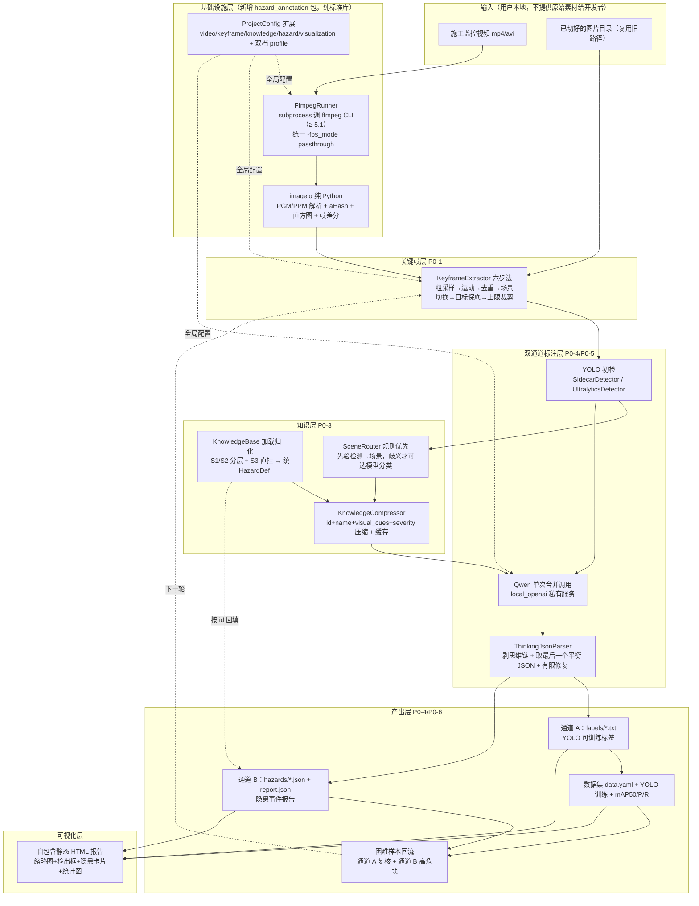
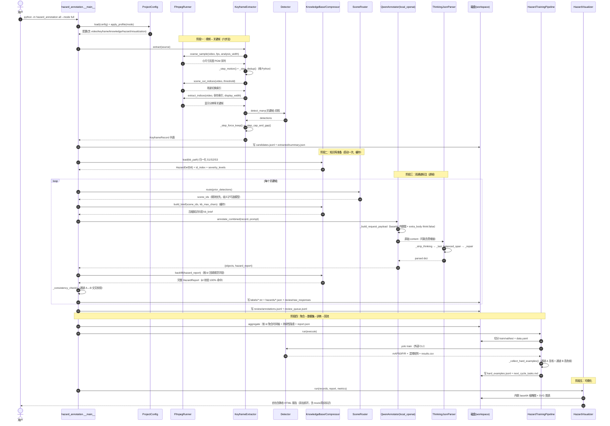

# 工业施工安全隐患自动标注系统 — 系统架构设计（ARCH）

- **文档类型**：系统架构设计 + 任务分解（毕设项目）
- **文档语言**：中文
- **项目代号**：`hazard_annotation`
- **上游输入**：`deliverables/software-company/PRD-hazard-annotation.md`（六节齐全）
- **设计基线（已 Read 确认）**：`traffic_cv_closed_loop/`（config.py / models.py / pipeline/*.py / adapters/*.py / prompting.py / diagnostics.py / cli.py / 1.py / tests）、`hazard-detection/`（knowledge_base.json / prompt_templates.md / detection_examples.md）、`examples/mock_project/`、`pyproject.toml`。
- **写作约束**：全中文；**不使用表格**（一律用列表分块）；Mermaid 图必须可直接渲染。

---

## 0. 阅读指引与设计基线

本设计在**不破坏现有交通闭环**的前提下，新增一条施工安全隐患双通道链路。三条铁律贯穿全文：

1. **交通模式零回归**：`traffic_cv_closed_loop/` 现有 3 个 unittest（`test_pipeline.py` / `test_production_integration.py` / `test_skills_delivery.py`）必须保持全绿；旧配置文件必须仍能加载。
2. **纯标准库 + 仅 ffmpeg 外部二进制**：不引入 OpenCV / numpy / Pillow 等任何第三方 Python 包；YOLO 沿用现有"调外部 `yolo` CLI"的方式。
3. **无视频、无模型也能跑通**：mock 数据（sidecar 机制）必须覆盖全链路，一条命令零报错。

现有骨架的关键事实（决定改造方式）：

- `ProjectConfig` 是**扁平 dataclass**，`load()` 只读 5 段（input/output/pipeline/qwen/yolo），`validate()` + `to_dict()` 齐全，有 `label_to_index` / `qwen_chat_endpoint` 等 property。
- `pipeline/extraction.py` **只吃已切好的图片目录**，按 `frame_step` 等间隔抽样，不读视频、无运动检测、无去重。
- `adapters/qwen.py` 的 `OpenAICompatibleQwenAnnotator` 已支持 base64 内联图 + 重试 + `response_format=json_object`；**`_extract_json_from_text` 是"取第一个像 JSON 的片段"，thinking 模型会误抓思维链里的花括号**（本设计必须修）。
- `adapters/yolo.py` 有 `SidecarDetector`（读 `<stem>.detections.json`）/ `UltralyticsDetector`（调 `yolo` CLI）与 `MockTrainer` / `UltralyticsTrainer`。
- `io_utils.py` 提供 `read_json/write_json/read_jsonl/write_jsonl/read_text/write_text/copy_file/iter_image_files/stem_sidecar/image_mime_type`，且 `SUPPORTED_IMAGE_SUFFIXES` **已包含 `.ppm` / `.pgm`**（关键：纯 Python 图像链路可直接复用）。
- `knowledge_base.json` 结构**不一致**：S1/S2 走 `scenes[].hazard_categories[].hazards[]` 分层；S3 的 `hazards[]` 直挂在 scene 下；`ten_no_lift` / `crane_six_forbidden` / `severity_levels` 在顶层。

---

## 1. 实现方案总览

### 1.1 总体架构图



### 1.2 改造点清单

**新增（不改动交通逻辑）**

- 新建独立包 `hazard_annotation/`，承载全部施工安全隐患领域代码；通过 `import traffic_cv_closed_loop.xxx` 复用 `io_utils` / `models.Detection` / `adapters`。
- 新增 `examples/hazard_project/`（真实视频配置）与 `examples/hazard_mock_project/`（mock 全链路资产）。
- 新增 `hazard_annotation/prompts/`（合并 Prompt、场景路由 Prompt、知识库片段模板）。

**修改（向后兼容，默认值兜底）**

- `traffic_cv_closed_loop/config.py`：`ProjectConfig` 增加 5 段配置对象 + 6 个 qwen 新字段 + `run_mode`/`profiles` 支持；`validate()` 补关键帧/知识库/预算校验；`to_dict()` 补字段；新增 `apply_profile()`。**所有新字段有默认值**，旧 `examples/mock_project/config/project.json` 与 `examples/production_project/config/*.json` 仍可加载。
- `traffic_cv_closed_loop/adapters/qwen.py`：修复 `_extract_json_from_text`（改为稳健解析）；新增 `local_openai` provider 分支；新增 `annotate_combined()`；thinking 关闭参数注入；mock 分支兼容 `*.hazard.json` 与合并 sidecar。
- `traffic_cv_closed_loop/diagnostics.py`：`build_doctor_report` 增加 video/keyframe/knowledge 检查项；新增 `probe_hazard()`（可选）。
- `README.md` / `docs/`：补充施工隐患链路说明与命令。

**明确不改动**

- `pipeline/extraction.py` / `pipeline/annotation.py` / `pipeline/training.py` 的交通语义逻辑保持原样（施工链路在 `hazard_annotation/` 内自行编排，必要时**调用**它们，而不是改写它们）。
- `1.py` 保持交通入口不变；施工链路用 `python -m hazard_annotation` 独立入口（避免污染被测入口）。

---

## 关键设计决策结论（逐条，先看这里）

### 决策 1：类别体系 — 最终 labels 数组

**最终结论（12 类，直接写入配置 `labels`）**：

```
["person", "helmet", "vest", "harness", "hook", "rigging",
 "overhead_crane", "load", "ladder", "scaffold", "guardrail", "pallet"]
```

**相对 PRD 17 类建议的合并/删减与理由**：

- `chain` + `sling` + `wire_rope` → **合并为 `rigging`（吊索具）**。三者在监控分辨率下视觉上几乎无法区分，且知识库 D-1 本身就把它们当作"吊索具"统一处理；拆三类只会把本就稀缺的样本再稀释成每类个位数，直接拉低 mAP50（YOLO 的 mAP50 是**按类平均**，个位数样本类几乎必然拉胯）。
- `spreader_beam`（平衡梁）→ **删除**。对应隐患 D-3-3"大件物品未使用平衡梁"本质是**缺失态**（没用到才违规），应由通道 B 结合场景推理，而不是让检测器去学一个"很少出现的实体"。
- `hopper`（料斗）→ **删除**。同理 D-3-1"散件未用料斗"是缺失态推理；料斗本体在 300~500 帧里出现次数极少，属典型长尾噪声。
- `mobile_scaffold` → **并入 `scaffold`**。检测层只需"存在脚手架"这一实体；G-5"移动脚手架"的细分规则由通道 B 依据知识库判断，不依赖通道 A 分类。
- 保留 `pallet`：它虽是长尾，但它是 D-2-3 / D-2-5 里**具体存在的违规对象**（"使用卡板吊物"），实体检测有意义，故保留但在验收里标注为"观察类"。
- 保留 `guardrail`：高处场景高频实体，且是 G-1 系列的关键锚点。

**长尾风险量化说明**：按 300~500 关键帧、train 占比 ~70% 估算，训练集约 200~350 张。`rigging`/`overhead_crane`/`load`/`ladder`/`scaffold`/`person`/`helmet` 属高频，可达数十至数百实例；`vest`/`harness`/`hook`/`guardrail` 属中频；`pallet` 属低频（可能 <15 实例）。**低频类在答辩报告中单独说明"样本不足、指标仅供参考"**，不参与 mAP50 达标承诺。

**兜底**：若导师坚持 17 类，配置 `labels` 可直接改回 17 项（代码对类别数量不敏感，`label_to_index` 自动生成），但需接受 mAP50 下降与标注成本上升；本设计默认交付 12 类版本。

### 决策 2：关键帧提取六步的落地手段

**ffmpeg 最小能力集（只需这些参数/滤镜）**：

- `-i <video>`：读输入。
- `-vf "fps=<sample_fps>"`：粗采样（默认 1 fps，避免逐帧读满 9 万帧）。
- `scale=<w>:-1`：等比缩放。
- `format=gray`：转灰度（用于分析帧）。
- `-fps_mode passthrough`：不做帧率对齐，保留实际抽出的帧。**注意：旧参数 `-vsync 0` 已在 ffmpeg 9.x 被移除，禁止使用；统一改用 `-fps_mode passthrough`（ffmpeg ≥ 5.1 支持）。**
- `-f image2 -pix_fmt gray` + `%06d.pgm`：输出二进制 PGM（P5），便于纯 Python 解析。
- `select='gt(scene,<N>)'` + `showinfo`：**场景切换优先走 ffmpeg 自带滤镜**（`scene` 是 ffmpeg 内置的场景分数），通过解析 stderr 的 `showinfo` 行拿到 `pts_time`。
- `select='eq(n\,i1)+eq(n\,i2)+...'`：按"采样后索引"精确抽出保留下来的关键帧（避免重解码全量）。
- `-f null -`：只做分析不落盘的 dry-run（用于场景分数预计算）。

**六步落地**：

1. **粗采样**：`ffmpeg -i IN -vf "fps=<sample_fps>,scale=<analysis_width>:-1,format=gray" -fps_mode passthrough -f image2 -pix_fmt gray analysis/%06d.pgm`。分析帧默认宽 `analysis_width=160`。帧序号 i ↔ 时间 `i / sample_fps`。（`-fps_mode passthrough` 取代已移除的 `-vsync 0`，见 2.4 版本约束。）
2. **运动检测（纯 Python）**：对相邻两张同尺寸灰度帧，逐字节求 `abs(a-b) > pixel_delta_threshold` 的像素数，`motion_ratio = count / (w*h)`；`< motion_min_ratio` 判为静止剔除。
3. **感知去重（纯 Python aHash）**：把灰度帧**分块平均**缩到 `phash_size × phash_size`（默认 8×8），求均值，逐格置 1/0 得位串；相邻帧汉明距离（XOR 后 popcount）`< dedup_hamming_threshold` 只留代表帧。
4. **场景切换强制保留**：优先用 `ffmpeg -i IN -vf "select='gt(scene,<scene_change_threshold>)',showinfo" -f null -` 解析 `pts_time`，换算成采样索引后强制保留；若 `scene_detect_mode=histogram`（无 ffmpeg 场景分数时兜底），用纯 Python 的 16 桶灰度直方图 L1 距离 / 2 作为场景变化度，超阈值强制保留。
5. **目标驱动保底**：对第 3、4 步的幸存帧跑 YOLO 初检，命中 `keyframe.force_keep_labels`（默认 `["person","hook","rigging","overhead_crane","ladder","scaffold","harness","load"]`）的帧强制保留。
6. **上限裁剪与最小间隔**：按优先级（场景切换 > 目标命中 > 运动分数高）贪心选取，保证相邻关键帧时间间隔 `>= min_gap_seconds`（默认 2s），总数不超过 `max_keyframes`（默认 400）。

**纯 Python 无 numpy 的关键实现**：

- **PGM(P5) 解析**：读全字节 → 解析头部（magic `P5`、width、height、maxval，跳过 `#` 注释）→ 其后 `width*height` 字节即灰度栅格 → 返回 `(w, h, bytes)`。
- **PPM(P6) 解析**：同上，magic `P6`，其后 `width*height*3` 字节 RGB；分析用灰度时按 `(r+g+b)//3` 降为灰度（或让 ffmpeg 直接出 gray，避免转换）。
- **分块平均缩图**：把 `w×h` 按 `phash_size` 分块，块内求和取均值（整数运算），无第三方依赖。
- **直方图**：遍历灰度字节，`bucket = value // 16` 累加 16 桶，归一化。
- **帧差分**：`zip(a_bytes, b_bytes)` 逐对比较。

**参数暴露到配置**：见第 4 节 `VideoConfig` / `KeyframeConfig`（`sample_fps`、`scale_width`、`analysis_width`、`decode_backend`、`motion_min_ratio`、`pixel_delta_threshold`、`dedup_hamming_threshold`、`phash_size`、`scene_change_threshold`、`scene_detect_mode`、`max_keyframes`、`min_gap_seconds`、`force_keep_labels`）。

### 决策 3：知识库压缩注入的数据流 + 场景路由

**数据流管线**：

1. `KnowledgeBase.load(kb_path)` 读 `knowledge_base.json`。
2. **归一化**：把结构不一致的两种形态统一成 `list[HazardDef]`：
   - S1/S2：遍历 `scenes[].hazard_categories[].hazards[]`，每条继承 `category_id/category_name`。
   - S3：直接遍历 `scenes[].hazards[]`。
   - 同时解析 `ten_no_lift.rules` / `crane_six_forbidden.rules` / `severity_levels`。
   - **解析结果共 58 条**：S1 吊装作业 **27 条**（D-1 共 7、D-2 共 5、D-3 共 7、D-4 共 3、D-5 共 5）；S2 高处作业 **30 条**（G-1 共 5、G-2 共 4、G-3 共 3、G-4 共 11、G-5 共 4、G-6 共 3）；S3 通用隐患 **1 条**（T-1 场地积水，`hazards` 直挂结构）。**`meta.total_hazards` 字段（写 53）不可信，以解析结果 58 条为准。**
3. 建 **`id_index: dict[str, HazardDef]`**，覆盖全部 58 条（含 `T-1`），用于**本地回填**。（**注意：`knowledge_base.json` 的 `meta.total_hazards` 字段是陈旧错误数据（写 53，实际 58），代码与测试一律以解析结果 58 条为准，禁止读取该字段做断言。**）
4. `KnowledgeCompressor.build_brief(scene_ids, kb_max_chars)` 生成注入文本：每条只保留 **`id + name + visual_cues + severity`**，丢弃 `description/action/norm_ref`（这三项由系统按 id 回填）；吊装场景额外附加 `ten_no_lift` / `crane_six_forbidden`。超 `kb_max_chars` 时按 `severity`（critical→low）截断并告警。
5. **缓存**：按 `scene_ids` 组合在启动时生成一次并缓存（避免每帧重复序列化）。

**场景路由结论：规则优先（默认），模型分类为可选兜底。**

- 理由：主模型是 30B 带 thinking，**单帧极慢**；若每帧都先来一次"场景分类调用"，等于每帧 2 次大模型调用，直接翻倍耗时——这正是 PRD 反复担心的点。
- 规则来源：用**通道 A 的先验检测标签**映射场景——`{hook, rigging, overhead_crane, load} → S1`；`{ladder, scaffold, guardrail, harness} → S2`；两者都有 → `S1+S2`；都没有 → 视为不确定。
- **视频级缓存**：固定机位单路视频通常整段同一场景，可**在视频首 N 帧（默认 5 帧）确定一次场景**并复用整段，进一步省调用。
- 兜底：`knowledge.scene_routing = "auto"` 时，仅当规则不确定才发起**一次**轻量分类调用（`prompt_templates.md` 场景 B 第一步）；`scene_routing = "rules"` 永不调用模型；`scene_routing = "model"` 强制每帧分类（消融实验用）。

### 决策 4：thinking 稳健解析算法

**步骤（`ThinkingJsonParser.parse(text) -> dict`）**：

1. 若 `qwen.enable_thinking=false` 且服务端已按 `extra_body`（Ollama 的 `think:false` 或 `chat_template_kwargs={"enable_thinking":false}`）真正关闭思维链，则 content 通常已是纯 JSON，直接进入第 5 步。
2. **剥离思维链**：正则非贪婪、`DOTALL` 循环删除 ` thinking...<｜end▁of▁thinking｜>` 与 `<|thinking|>...<|/thinking|>`；同时删除以 ```` ```thinking ```` 开头的围栏代码块。
3. 若存在 ```` ```json ... ``` ```` 围栏，优先取围栏内文本作为候选。
4. **取"最后一个平衡 JSON"**：用一个**字符串感知**的状态机（跟踪是否在字符串内、是否转义）扫描全文，记录所有**顶层平衡**的 `{...}` / `[...]` 片段区间；**取最后一个**（思维链在前、最终答案在后）。这是与现有 `_extract_json_from_text`（取第一个）最本质的差异。
5. `json.loads` 该片段；失败则对该片段尝试有限修复后重试。
6. **JSON 修复（有限规则集）**：
   - 删除 `}` / `]` 前的尾随逗号；
   - Python 字面量 `True/False/None` → `true/false/null`；
   - 单引号字符串转双引号（仅对未被双引号包裹的引号做启发式替换）；
   - 删除 `//...` 与 `/*...*/` 注释；
   - **截断恢复**：统计未闭合的 `{`/`[` 深度，在末尾补齐对应闭合符。
7. 全部失败 → 抛异常；调用方写入复核队列并**保留原始响应**（严禁静默丢帧）。
8. 返回解析后的 dict，交由上层拆分为 `objects`（通道 A）与 `hazard_report`（通道 B）。

**配置开关**：`qwen.enable_thinking`、`qwen.strip_thinking`、`qwen.json_repair`（默认 true）。

### 决策 5：单次合并调用 vs 两次调用

- **默认 `qwen.combined_call = true`**：一次调用返回 `{ "objects": [...], "hazard_report": {...} }`。理由：30B 带 thinking 单帧很慢，合并调用是性能关键路径。
- **开关 `qwen.combined_call = false`**：回退两次独立调用——第 1 次只出 `objects`（通道 A），第 2 次出 `hazard_report`（通道 B，并注入第 1 次的 `prior_detections`）。用于调试、消融实验、以及"合并输出不稳定"时的降级。
- 验收：`combined_call=true` 时单帧**只发生 1 次模型请求**（日志/探针可证）。

### 决策 6：quick/full 双档模式

- 配置顶层 `run_mode`（`quick` / `full`），并在 `profiles` 段给出覆盖值；`ProjectConfig.apply_profile(mode)` 把覆盖叠加到基础值上。CLI 用 `--mode quick|full` 覆盖。
- **`quick` / `dev`（低性能云服务器，快速迭代）**：`sample_fps=0.5`、`max_keyframes=30`、`qwen.timeout_seconds=90`、`qwen.max_retries=1`、`qwen.concurrency=1`、`knowledge.kb_max_chars=4000`、`qwen.max_tokens=1500`、`combined_call=true`。
- **`full`（4090D 全量验证）**：`sample_fps=1`、`max_keyframes=400`、`qwen.timeout_seconds=300`、`qwen.max_retries=2`、`qwen.concurrency=2`、`knowledge.kb_max_chars=8000`、`qwen.max_tokens=2500`、`combined_call=true`。
- **两台服务器切换**：只改 `qwen.base_url`（`quick` 指向低性能服务器，`full` 指向 4090D 或原服务器），`base_url` 完全可配置，代码不含任何硬编码地址。

### 决策 7：mock 资产构造

- 目录 `examples/hazard_mock_project/`：`input/frames/<source_id>/` 放**合成关键帧图片**（复用现有 `.ppm` 方式，纯文本 P3 或二进制 P6 均可），每帧配三类 sidecar：
  - `<stem>.detections.json`：通道 A 的 YOLO 初检（mock）。
  - `<stem>.qwen.json`：Qwen 合并输出 `{objects, hazard_report}`（或仅 objects，用于非合并路径）。
  - `<stem>.hazard.json`：通道 B 的隐患报告（当 `combined_call=false` 或需要独立覆盖时）。
- **覆盖三类场景（对齐 `detection_examples.md`）**：
  1. **吊装多隐患**：D-1-1 绳索交叉、D-3-1 散件未用料斗、D-5-1 未戴安全帽、D-5-3 站在吊物下方（critical）、D-4-1 照明不足；`overall_risk=critical`。
  2. **高处梯具违规**：G-4-6 踩最高梯面、G-4-5 单人作业、G-4-4 梯脚无防滑、G-2-2 未系安全带（critical）；`overall_risk=critical`。
  3. **无隐患**：`hazards=[]`、`overall_risk=none`、带 `observations`。
- **可选合成视频**：提供 `scripts/make_mock_video.ps1`，用 ffmpeg（`-f lavfi -i testsrc` 或把合成帧 `-f image2` 串成 mp4）生成一段几秒的假视频，**让"视频→关键帧"路径也能被真实 ffmpeg 走通**；无 ffmpeg 时自动跳过，回落到图片目录路径。
- **mock 与真实的区分**：由 `qwen.provider=mock` / `yolo.detector=sidecar` / `yolo.trainer=mock` 判定；所有产出 JSON 带 `"provider":"mock"`，训练报告带 `"trainer_mode":"mock"`，HTML 报告顶部**醒目标注"演示数据（mock）"**。

### 决策 8：4090D 显存核对与部署拓扑（**已拍板：方案 c 职责拆分**）

- 事实：`qwen3-vl:30b-a3b-thinking-q8_0` 的 q8_0 约 8.5 bit/权重，30B × 8.5/8 ≈ **32GB**，**> 4090D 的 24GB**，**单卡装不下**。
- **最终决策（用户已拍板）：采用方案 (c) 职责拆分**——
  - **4090D（24GB）只跑：YOLO 训练 + 全量流水线 + HTML 报告**（这些负载对 24GB 显存充裕）；
  - **VL 模型（`qwen3-vl:30b-a3b-thinking-q8_0`）留在能容纳 q8 的原服务器**，通过 `base_url` 被 4090D 上的流水线远程调用。
- **代码层无需特殊处理**：`qwen.base_url` + `qwen.model` 完全可配置，4090D 的 `full` 档指向 VL 所在服务器的 `base_url` 即可；流水线本身不关心模型跑在哪台机器。
- 备选（记录备查，不再需要用户决策）：(a) VL 降 q4（~18GB，可整卡驻留 4090D）/ (b) CPU offload（极慢，仅兜底）/ (d) 双模型并存（4090D 常驻 q4 VL + YOLO）。
- 相关约束：请确保 VL 所在服务器与 4090D 之间的网络连通、且 `base_url` 对 4090D 可达；推理请求仍属"自有服务"，符合决策 9 的隐私口径。

### 决策 9：隐私验收口径（**最终口径，已定稿**）

- 原 PRD 第 1 节目标 4"断网可跑、零外网请求"**已不成立**：主模型 `qwen3-vl:30b-a3b-thinking-q8_0` 私有部署在云端自有服务器上，推理必须走网络。
- **最终口径（以此为准）**：**"视频帧只发往用户自有的模型服务（自部署 `base_url`），不经任何第三方 API；云端百炼通道默认关闭，仅在配置显式切换时才可被调用。"**
- 同步修订：PRD 目标 4 的验收改为"帧数据仅流向用户自有 endpoint；百炼默认关闭可通过配置审计证明"。

---

## 2. 框架与依赖选型

### 2.1 选型结论

- **语言/运行时**：Python ≥ 3.11（沿用 `pyproject.toml` 既有 `requires-python`）。
- **Python 第三方包**：**尽量为零**。运行时仅用标准库：`subprocess`（调 ffmpeg / yolo）、`urllib.request`（OpenAI 兼容 HTTP）、`base64`、`json`、`dataclasses`、`pathlib`、`re`、`shutil`、`argparse`、`collections`、`datetime`、`html`（HTML 转义）、`random`、`csv`。
- **外部二进制**：`ffmpeg`（视频解码/抽帧/场景分数）、`yolo`（Ultralytics CLI，训练与真实检测，沿用现有方式）。

### 2.2 为何不引入 OpenCV / numpy / Pillow

- **工程一致性**：现有工程是"纯标准库"风格，`adapters/yolo.py` 调外部 `yolo` CLI，不 import 重库；保持同一风格可降低环境依赖与答辩翻车风险。
- **部署可移植性**：用户要"在自己环境直接运行"，OpenCV/numpy 的 wheel 在 Windows + 不同 Python 版本上易踩坑；ffmpeg 单文件二进制更省事。
- **算法需求足够简单**：本设计只需要"小图灰度字节比较 + 分块平均 + 直方图"，这些用 `bytes`/`int` 运算几十行即可，无需向量化。
- **性能可接受**：分析帧仅 160px 宽、且已降到 ~1fps，纯 Python 处理数千张小图在秒级~十秒级，不构成瓶颈；真正的重活（解码）交给 ffmpeg。

### 2.3 ffmpeg 最小能力集（要调的具体滤镜/参数）

- 抽帧与缩放：`-vf "fps=<f>,scale=<w>:-1"`，`-fps_mode passthrough`（**不是** `-vsync 0`）。
- 灰度分析帧：`format=gray`、`-f image2 -pix_fmt gray`，输出 `%06d.pgm`。
- 场景分数：`select='gt(scene,<N>)'` 配合 `showinfo`（解析 stderr 的 `pts_time:`）。
- 精确抽帧：`select='eq(n\,i1)+eq(n\,i2)+...'`（n 为前序 `fps` 滤波后的索引）。
- dry-run：`-f null -`。
- 媒体信息（取源 fps，用于采样索引换算，替代 ffprobe）：`ffmpeg -i IN` 的 stderr 中 `... fps` 字段。

### 2.4 ffmpeg 版本硬约束（**阻断级，实测得出**）

- **最低版本要求：ffmpeg ≥ 5.1**。原因：本设计用 `-fps_mode passthrough` 取代已废弃的 `-vsync 0`，而 `-fps_mode` 正是 **ffmpeg 5.1 引入**的。
- **实测踩坑记录**：在真实 ffmpeg **9.0.1** 上，`-vsync` 选项**已被移除**，直接导致"视频→关键帧"链路完全跑不起来；改用 `-fps_mode passthrough` 后恢复正常。**代码与脚本一律禁止出现 `-vsync`**。
- **部署风险提示**：Ubuntu 上 `apt` 默认安装的 ffmpeg 版本可能偏新（如 6.x/7.x）也可能偏旧（如 4.x），**部署前必须先核对版本**。
- **核对方式**：执行 `python -m hazard_annotation doctor`，其 `video` 检查项会输出 `ffmpeg` 路径与版本，并对 `< 5.1` 明确告警；版本不达标时**不得**启动视频链路，应回落到图片目录模式或提示升级。
- `scripts/*.ps1` 与 `hazard_annotation/ffmpeg.py` 中所有抽帧命令统一使用 `-fps_mode passthrough`。

---

## 3. 文件列表及相对路径

**目录结构决策**：新建独立包 `hazard_annotation/`，**不把施工语义塞进 `traffic_cv_closed_loop/`**。理由：(1) 交通链路与其测试完全隔离，零回归风险；(2) 施工链路可自由演进而不牵动交通；(3) 通过 import 复用 `io_utils`/`models`/`adapters`，不重复造轮子。仅对 `config.py` 与 `adapters/qwen.py` 做**向后兼容的扩展式修改**。

### 3.1 新增文件

- `hazard_annotation/__init__.py`：包标识与版本号。
- `hazard_annotation/__main__.py`：施工链路 CLI 入口（`python -m hazard_annotation`），支持 `--stage extract|annotate|train|aggregate|visualize|all|status|doctor|probe-qwen|demo` 与 `--mode quick|full`、`--mock`。
- `hazard_annotation/config.py`：profile 叠加与 `run_mode` 解析辅助（薄封装，主体字段仍在 `ProjectConfig`）。
- `hazard_annotation/models.py`：`HazardDef` / `HazardEvent` / `HazardReport` / `KeyframeRecord` / `DualChannelRecord` 数据类（含 `to_dict/from_dict`）。
- `hazard_annotation/ffmpeg.py`：`FfmpegRunner`——可用性探测、**版本探测（要求 ≥ 5.1）**、源 fps 探测、粗采样、精确抽帧、场景分数预计算（封装 `subprocess`，统一用 `-fps_mode passthrough`）。
- `hazard_annotation/imageio.py`：纯 Python `PgmImage`/`PpmImage` 解析、`to_gray_bytes`、`ahash`、`hamming`、`histogram16`、`histogram_delta`、`motion_ratio`、`block_downscale`。
- `hazard_annotation/knowledge.py`：`KnowledgeBase`（加载 + 归一化 S1/S2/S3 + `id_index`）、`KnowledgeCompressor`（压缩注入 + 缓存）、`SceneRouter`（规则优先 + 可选模型分类）、`backfill(hazard_report)`（按 id 回填 `category/description/norm_reference/action`）。
- `hazard_annotation/keyframes.py`：`KeyframeExtractor`——六步法编排，产出 `KeyframeRecord` 列表 + `summary.json`。
- `hazard_annotation/pipeline/__init__.py`：子包标识。
- `hazard_annotation/pipeline/extraction.py`：施工版 `run_extraction()`——视频/图片目录 → 关键帧 → 写 `candidates.jsonl`（沿用交通字段）与 `extracted/summary.json`。
- `hazard_annotation/pipeline/annotation.py`：施工版 `run_annotation()`——合并调用、拆双通道、回填、双落盘、复核队列、通道一致性校验（P1-3）、并发与断点续跑（P1-4）。
- `hazard_annotation/pipeline/aggregate.py`：`run_aggregate()`——逐帧隐患按 id 沿时间轴聚合、持续性隐患（P1-1）、`report.json`。
- `hazard_annotation/pipeline/training.py`：施工版 `run_training()`——复用交通训练能力 + **通道 B 高危帧回流**困难样本。
- `hazard_annotation/pipeline/visualization.py`：`run_visualize()`——自包含静态 HTML（内联 base64 缩略图、内联 CSS/JS、纯 Python 计算的 SVG 柱状/饼/折线图）。
- `hazard_annotation/demo.py`：`build_mock_assets()` + `run_demo()`——无视频无模型一键全链路。
- `hazard_annotation/diagnostics.py`：施工版 `build_doctor_report()` / `probe_qwen_service()` / `probe_detector()` 包装与扩展。
- `hazard_annotation/prompts/combined_zh.md`：通道 A+B 合并 Prompt（含 `{scene}`/`{labels}`/`{candidate_path}`/`{prior_detections}`/`{kb_brief}` 占位符）。
- `hazard_annotation/prompts/scene_route_zh.md`：场景分类轻量 Prompt（兜底路由用）。
- `hazard_annotation/prompts/objects_only_zh.md` / `hazard_only_zh.md`：`combined_call=false` 时的两次独立 Prompt。
- `examples/hazard_project/config/project.json`：真实视频配置（`run_mode=full`）。
- `examples/hazard_project/assets/prompts/`：可覆盖的 Prompt 副本。
- `examples/hazard_mock_project/config/project.json`：mock 配置（`provider=mock`/`detector=sidecar`/`trainer=mock`）。
- `examples/hazard_mock_project/input/frames/<source_id>/`：合成 `.ppm` 关键帧 + 三类 sidecar。
- `examples/hazard_mock_project/assets/prompts/`：mock Prompt。
- `scripts/run_hazard_demo.ps1`：一条命令跑通 mock 全链路。
- `scripts/make_mock_video.ps1`：用 ffmpeg 合成测试视频（可选）。
- `tests/test_hazard_pipeline.py`：施工链路端到端（mock 全链路零报错 + 三类场景断言）。
- `tests/test_hazard_parsing.py`：`ThinkingJsonParser` 单元测试（含思维链带花括号、尾逗号、截断）。
- `tests/test_hazard_knowledge.py`：知识库归一化（58 条 + id_index）、压缩长度、场景路由、回填。
- `tests/test_hazard_imageio.py`：PGM/PPM 解析、aHash、汉明、运动比、直方图。

### 3.2 修改文件

- `traffic_cv_closed_loop/config.py`：扩展 `ProjectConfig`（新增 5 段配置 + qwen 新字段 + `run_mode`/`profiles` + `apply_profile` + `validate`/`to_dict` 补全），保持旧配置可加载。
- `traffic_cv_closed_loop/adapters/qwen.py`：修复 `_extract_json_from_text`；新增 `local_openai` 分支、`annotate_combined`、thinking 关闭注入、mock 兼容 `*.hazard.json`。
- `traffic_cv_closed_loop/diagnostics.py`：`build_doctor_report` 增加 video/keyframe/knowledge 检查。
- `README.md`：新增施工隐患链路章节与命令示例。
- `docs/`：新增/更新施工链路说明文档。

---

## 4. 数据结构与接口（classDiagram）

```mermaid
classDiagram
    class ProjectConfig {
        +Path config_path
        +Path project_dir
        +str name
        +str scene
        +str run_mode
        +list~str~ labels
        +VideoConfig video
        +KeyframeConfig keyframe
        +KnowledgeConfig knowledge
        +HazardConfig hazard
        +VisualizationConfig visualization
        +dict profiles
        +load(path) ProjectConfig
        +validate() None
        +apply_profile(mode) None
        +to_dict() dict
        +label_to_index() dict
    }

    class VideoConfig {
        +str video_path
        +float sample_fps
        +int scale_width
        +int analysis_width
        +str decode_backend
        +str ffmpeg_binary
    }

    class KeyframeConfig {
        +bool enable
        +float motion_min_ratio
        +int pixel_delta_threshold
        +int dedup_hamming_threshold
        +int phash_size
        +float scene_change_threshold
        +str scene_detect_mode
        +int max_keyframes
        +float min_gap_seconds
        +list~str~ force_keep_labels
    }

    class KnowledgeConfig {
        +str kb_path
        +str kb_mode
        +int kb_max_chars
        +str scene_routing
        +bool include_ten_no_lift
        +bool include_crane_six_forbidden
    }

    class HazardConfig {
        +str output_dir
        +dict severity_levels
        +str overall_risk_policy
    }

    class VisualizationConfig {
        +bool enable
        +str output_dir
        +int thumbnail_size
    }

    class HazardDef {
        +str id
        +str name
        +str category
        +str severity
        +list~str~ visual_cues
        +str description
        +str norm_ref
        +str action
        +str scene_id
    }

    class KnowledgeBase {
        +list~HazardDef~ hazards
        +dict id_index
        +dict severity_levels
        +list~dict~ ten_no_lift
        +list~dict~ crane_six_forbidden
        +load(path) KnowledgeBase
        +scene_ids() list~str~
        +get(hazard_id) HazardDef
    }

    class KnowledgeCompressor {
        +KnowledgeBase kb
        +dict cache
        +build_brief(scene_ids, max_chars) str
        +backfill(report) HazardReport
    }

    class SceneRouter {
        +str mode
        +route(prior_detections) list~str~
        +route_by_video(prior_frames) list~str~
    }

    class FfmpegRunner {
        +str binary
        +available() bool
        +version() str
        +check_min_version(min_major, min_minor) bool
        +probe_source_fps(video) float
        +coarse_sample(video, out_dir, fps, width) list~Path~
        +extract_indices(video, out_dir, fps, indices, width) list~tuple~int,Path~~
        +scene_cut_indices(video, fps, threshold) list~int~
    }

    class PgmImage {
        +int width
        +int height
        +bytes pixels
        +load(path) PgmImage
        +to_gray_bytes() bytes
    }

    class ImageStats {
        +int phash_size
        +ahash(img) int
        +hamming(a, b) int
        +histogram16(img) list~float~
        +histogram_delta(h1, h2) float
        +motion_ratio(a, b, delta) float
        +block_downscale(img, size) list
    }

    class KeyframeExtractor {
        +ProjectConfig config
        +FfmpegRunner ffmpeg
        +ImageStats stats
        +extract(source) list~KeyframeRecord~
        +_step_coarse_sample()
        +_step_motion()
        +_step_dedup()
        +_step_scene_cut()
        +_step_force_keep()
        +_step_cap_and_gap()
    }

    class KeyframeRecord {
        +str source_id
        +str relative_path
        +str original_path
        +str extracted_path
        +float timestamp
        +str reason
        +list~Detection~ detections
        +to_dict() dict
    }

    class Detection {
        +str label
        +tuple bbox
        +float confidence
        +str source
        +str notes
        +to_yolo_line(map) str
        +iou(other) float
        +from_dict(data) Detection
        +to_dict() dict
    }

    class HazardEvent {
        +str id
        +str category
        +str description
        +float confidence
        +str evidence
        +str severity
        +str norm_reference
        +str action
        +str scene_type
        +to_dict() dict
    }

    class HazardReport {
        +str scene_type
        +list~HazardEvent~ hazards
        +list~str~ ten_no_lift_violations
        +list~str~ crane_six_forbidden_violations
        +str overall_risk
        +str recommendation
        +from_dict(data) HazardReport
        +to_dict() dict
    }

    class DualChannelRecord {
        +KeyframeRecord keyframe
        +list~Detection~ objects
        +HazardReport hazard_report
        +dict diff
        +bool review_required
        +list~str~ review_reasons
        +str label_path
        +str hazard_path
        +str raw_response_path
        +bool dataset_ready
        +to_dict() dict
    }

    class ThinkingJsonParser {
        +bool strip_thinking
        +bool repair
        +parse(text) dict
        +_strip_thinking(text) str
        +_last_balanced_span(text) tuple
        +_repair(text) str
    }

    class QwenAnnotator {
        +ProjectConfig config
        +ThinkingJsonParser parser
        +annotate_combined(record, prompt) tuple
        +annotate(record, prompt) tuple
        +_build_request_payload(prompt, image)
        +_post_json(payload, headers) dict
    }

    class HazardAnnotationPipeline {
        +ProjectConfig config
        +QwenAnnotator annotator
        +KnowledgeBase kb
        +KnowledgeCompressor compressor
        +SceneRouter router
        +run() dict
        +_process_frame(record) DualChannelRecord
        +_consistency_check(record) list~str~
    }

    class HazardTrainingPipeline {
        +ProjectConfig config
        +run(execute) dict
        +_collect_hard_examples(records) list
        +_build_next_cycle_tasks() str
    }

    class Aggregator {
        +run(records) dict
        +persistent_hazards(records) list
        +timeline(records) list
    }

    class HazardVisualizer {
        +ProjectConfig config
        +run(records, report, metrics) Path
        +_render_bars(data) str
        +_render_pie(data) str
        +_render_line(points) str
        +_inline_thumbnail(path) str
    }

    ProjectConfig *-- VideoConfig
    ProjectConfig *-- KeyframeConfig
    ProjectConfig *-- KnowledgeConfig
    ProjectConfig *-- HazardConfig
    ProjectConfig *-- VisualizationConfig
    KnowledgeBase *-- HazardDef
    KnowledgeCompressor --> KnowledgeBase
    SceneRouter ..> Detection
    KeyframeExtractor ..> FfmpegRunner
    KeyframeExtractor ..> ImageStats
    KeyframeExtractor ..> PgmImage
    KeyframeExtractor --> KeyframeRecord
    KeyframeRecord *-- Detection
    HazardReport *-- HazardEvent
    DualChannelRecord *-- KeyframeRecord
    DualChannelRecord *-- Detection
    DualChannelRecord *-- HazardReport
    QwenAnnotator *-- ThinkingJsonParser
    HazardAnnotationPipeline ..> QwenAnnotator
    HazardAnnotationPipeline ..> KnowledgeCompressor
    HazardAnnotationPipeline ..> SceneRouter
    HazardAnnotationPipeline --> DualChannelRecord
    HazardTrainingPipeline ..> DualChannelRecord
    Aggregator ..> DualChannelRecord
    HazardVisualizer ..> DualChannelRecord
```



**接口要点说明**

- `KeyframeRecord` 字段刻意**兼容**交通版 `CandidateFrame`（`source_id/relative_path/original_path/extracted_path/detections`），使交通的 `extraction.py`/`training.py` 逻辑与既有 `SidecarDetector` 可直接消费施工关键帧。
- `DualChannelRecord` 是"双通道"的落点：`objects`（通道 A）+ `hazard_report`（通道 B）+ `diff`（YOLO↔Qwen 比对，沿用交通 `_compare_detections`）。
- `KnowledgeBase.get(id)` 与 `KnowledgeCompressor.backfill()` 共同保证 `hazards[].id` **100% 落在 58 条内**且规范字段由本地回填（杜绝模型编造规范号）。

---

## 5. 程序调用流程（sequenceDiagram）



**覆盖的关键操作**：初始化（config + KB 加载缓存）、视频读取（ffmpeg）、CRUD（关键帧/标签/隐患 JSON 的写、report 聚合）、训练与回流、可视化。

---

## 6. 任务列表（有序，按实现顺序编号）

> 说明：按架构职责**分组为 5 个任务**（每个任务含多个相关文件，符合"最大任务数 ≤ 5、最小粒度 ≥ 3 文件"的约束）。每个任务已细化到**文件路径与函数/类级**，工程师可零上下文开工。依赖尽量扁平（T2/T3 并行依赖 T1）。

### T1 — 基础设施：包骨架 + 配置扩展 + 纯 Python 图像/ffmpeg 底座

- **涉及文件**：
  - 新增 `hazard_annotation/__init__.py`
  - 新增 `hazard_annotation/__main__.py`
  - 新增 `hazard_annotation/config.py`
  - 新增 `hazard_annotation/models.py`
  - 新增 `hazard_annotation/ffmpeg.py`
  - 新增 `hazard_annotation/imageio.py`
  - 修改 `traffic_cv_closed_loop/config.py`
  - 新增 `tests/test_hazard_imageio.py`
- **要做什么**：
  - `traffic_cv_closed_loop/config.py`：新增 dataclass `VideoConfig` / `KeyframeConfig` / `KnowledgeConfig` / `HazardConfig` / `VisualizationConfig`；`ProjectConfig` 增加对应 5 个字段（**全部给默认值**）、`run_mode: str = "quick"`、`profiles: dict`、qwen 新字段（`qwen_enable_thinking`、`qwen_strip_thinking`、`qwen_json_repair`、`qwen_combined_call`、`qwen_concurrency`，provider 默认新增 `local_openai` 支持但**不改旧默认 `mock`**）；实现 `apply_profile(mode)`；在 `validate()` 补 `max_keyframes>=1`、`sample_fps>0`、`phash_size>=2`、`kb_max_chars>=200`、`min_gap_seconds>=0` 等校验；在 `to_dict()` 补全新字段（含 `video/keyframe/knowledge/hazard/visualization/run_mode`）。
  - `hazard_annotation/models.py`：实现 `HazardDef` / `HazardEvent` / `HazardReport` / `KeyframeRecord` / `DualChannelRecord`（均带 `to_dict/from_dict`，`KeyframeRecord` 字段兼容交通 `CandidateFrame`）。
  - `hazard_annotation/ffmpeg.py`：`FfmpegRunner`——`available()`（`shutil.which`）、`version()`（解析 `ffmpeg -version` 首行）、`check_min_version(5,1)`（**低于 5.1 返回 False 并由 doctor 告警**）、`probe_source_fps(video)`（解析 `ffmpeg -i` stderr）、`coarse_sample(...)`、`extract_indices(...)`、`scene_cut_indices(...)`（`select='gt(scene,N)'`+`showinfo` 解析 stderr）。**所有抽帧命令一律用 `-fps_mode passthrough`，禁止 `-vsync`。**
  - `hazard_annotation/imageio.py`：`PgmImage.load()` / `PpmImage.load()`（手写 P5/P6 头解析 + 栅格读取）、`to_gray_bytes()`、`ImageStats.ahash/hamming/histogram16/histogram_delta/motion_ratio/block_downscale`（纯 `bytes`/`int` 运算）。
  - `hazard_annotation/__main__.py`：argparse 骨架（`--stage` / `--mode` / `--mock` / `--config`），先只打通 `doctor` 与 `status`。
- **验收点**：
  - 旧配置 `examples/mock_project/config/project.json`、`examples/production_project/config/project.production.json` 仍能 `ProjectConfig.load()` 成功，且 `tests/test_pipeline.py`、`tests/test_production_integration.py`、`tests/test_skills_delivery.py` **全绿**。
  - 新配置缺省时 5 段配置全部取到默认值；非法值（如 `max_keyframes=0`）触发 `validate()` 报错。
  - `tests/test_hazard_imageio.py`：构造 2×2 P5/P6 已知字节，断言 `load()` 的 `width/height/pixels`；断言相同图 `hamming(ahash(a),ahash(a))==0`；断言两图 `motion_ratio` 符合手算值。
  - `python -m hazard_annotation doctor` 能在无 ffmpeg 环境返回 `status` 且不抛异常；在有 ffmpeg 的环境能输出其版本，且当版本 `< 5.1` 时给出明确告警。
  - 代码库中**不出现 `-vsync`**（可用 `grep -r "\-vsync"` 自查为零命中）。

### T2 — 知识库加载/压缩注入 + 场景路由 + 关键帧提取器

- **涉及文件**：
  - 新增 `hazard_annotation/knowledge.py`
  - 新增 `hazard_annotation/keyframes.py`
  - 新增 `hazard_annotation/pipeline/__init__.py`
  - 新增 `hazard_annotation/pipeline/extraction.py`
  - 新增 `tests/test_hazard_knowledge.py`
- **要做什么**：
  - `knowledge.py`：`KnowledgeBase.load(path)`——解析 `meta/scenes/ten_no_lift/crane_six_forbidden/severity_levels`；**归一化 S1/S2（`hazard_categories[].hazards[]`）与 S3（直挂 `hazards[]`）为统一 `HazardDef` 列表**；建 `id_index`（断言 58 条，含 `T-1`；**不得使用 `meta.total_hazards`**）；`scene_ids()` / `get(id)`。
  - `knowledge.py`：`KnowledgeCompressor.build_brief(scene_ids, max_chars)`——只保留 `id+name+visual_cues+severity`，吊装附加 `ten_no_lift`/`crane_six_forbidden`；超限按 severity 截断并告警；**按 scene_ids 缓存**。`backfill(report)`——按 id 回填 `category/description/norm_reference/action`，未命中 id 标记 `invalid_id`。
  - `knowledge.py`：`SceneRouter.route(prior_detections)`——标签→场景规则映射（`{hook,rigging,overhead_crane,load}→S1`、`{ladder,scaffold,guardrail,harness}→S2`）；`route_by_video(prior_frames)`——首 N 帧投票；`mode in {rules,auto,model}`。
  - `keyframes.py`：`KeyframeExtractor.extract(source)`——串起 `_step_coarse_sample/_step_motion/_step_dedup/_step_scene_cut/_step_force_keep/_step_cap_and_gap` 六步；产出 `KeyframeRecord` 列表与计数（总帧/采样/运动剔除/去重剔除/最终数）。
  - `pipeline/extraction.py`：`run_extraction(config)`——`video.video_path` 存在则走视频链路，否则回落到 `input.frames_dir` 图片目录（复用交通 `iter_image_files`）；写 `candidates.jsonl`（`KeyframeRecord.to_dict`）与 `workspace/extracted/summary.json`。
- **验收点**：
  - `tests/test_hazard_knowledge.py`：`id_index` 长度 == 58（S1 27 + S2 30 + S3 1）且含 `D-1-1`/`G-2-2`/`T-1`；`build_brief` 输出长度 ≤ `kb_max_chars`；`route` 对"含 hook+load"返回 `["S1"]`、对"含 ladder"返回 `["S2"]`；`backfill` 后 `norm_reference` 与知识库一致、非法 id 被标记。
  - 关键帧：给一段等价长序列（或合成视频）后，最终关键帧数 ≤ `max_keyframes`，`summary.json` 含五项计数，`min_gap_seconds` 生效。
  - 图片目录回落路径：直接吃 `examples/hazard_mock_project/input/frames/` 能产出 `candidates.jsonl`。

### T3 — 双通道标注 + thinking 稳健解析 + Qwen 适配器改造

- **涉及文件**：
  - 修改 `traffic_cv_closed_loop/adapters/qwen.py`
  - 新增 `hazard_annotation/pipeline/annotation.py`
  - 新增 `hazard_annotation/pipeline/aggregate.py`
  - 新增 `hazard_annotation/prompts/combined_zh.md`
  - 新增 `hazard_annotation/prompts/scene_route_zh.md`
  - 新增 `hazard_annotation/prompts/objects_only_zh.md`
  - 新增 `hazard_annotation/prompts/hazard_only_zh.md`
  - 新增 `tests/test_hazard_parsing.py`
- **要做什么**：
  - `adapters/qwen.py`：**重写 `_extract_json_from_text`** 为 `ThinkingJsonParser`（`_strip_thinking` 去 ` thinking`/`<|thinking|>`/```thinking 围栏；`_last_balanced_span` 字符串感知状态机取**最后一个**平衡 JSON；`_repair` 做尾逗号/单引号/Python 字面量/注释/截断补齐）；新增 `annotate_combined(record, prompt)` 返回 `{objects, hazard_report}`；`local_openai` provider 分支（`require_api_key=false`、`base_url` 可配、`extra_body` 注入 `think:false` / `chat_template_kwargs`）；mock 分支兼容合并 sidecar 与 `*.hazard.json`。
  - `pipeline/annotation.py`：`run_annotation(config)`——逐帧：路由→取 kb_brief→`annotate_combined`（或按 `combined_call` 走两次）→解析→`backfill`→拆通道→`_consistency_check`（模型报"未戴安全帽"但通道 A 有 helmet 框 → 标记可疑进复核）→写 `labels/*.txt`、`hazards/*.json`、`review/raw_responses/*.json`、`annotations.jsonl`、`review_queue.jsonl`；支持 `qwen_concurrency` 与断点续跑（已完成帧跳过）。
  - `pipeline/aggregate.py`：`run_aggregate(config)`——按 `hazards[].id` 沿时间轴聚合，输出持续性隐患与 `hazards/report.json`（时间轴 + 等级聚合 + `overall_risk`）。
- **验收点**：
  - `tests/test_hazard_parsing.py`：输入"思维链含 `{` `}` + 末尾真正 JSON"能取到正确 JSON；含尾逗号/单引号/截断的文本能被修复；无法修复时抛异常（不静默）。
  - 每个关键帧同时存在 `labels/*.txt`（通道 A）与 `hazards/*.json`（通道 B）；`hazards[].id` **100% 命中知识库**；必填字段完整率 ≥ 95%。
  - `combined_call=true` 时 mock 日志显示单帧仅 1 次调用。
  - 交通测试仍全绿（确认 qwen 改造无回归）。

### T4 — 数据集/训练闭环 + 困难样本回流 + mock 资产与一键 demo

- **涉及文件**：
  - 新增 `hazard_annotation/pipeline/training.py`
  - 新增 `hazard_annotation/demo.py`
  - 新增 `examples/hazard_mock_project/config/project.json`
  - 新增 `examples/hazard_mock_project/input/frames/<source_id>/*.ppm` 及三类 sidecar
  - 新增 `examples/hazard_mock_project/assets/prompts/*.md`
  - 新增 `examples/hazard_project/config/project.json`
  - 新增 `scripts/run_hazard_demo.ps1`
  - 新增 `scripts/make_mock_video.ps1`
  - 新增 `tests/test_hazard_pipeline.py`
- **要做什么**：
  - `pipeline/training.py`：`run_training(config, execute)`——复用交通切分/`data.yaml`/训练能力（`labels` 用施工 12 类）；`_collect_hard_examples(records)` 在交通"复核队列"基础上**新增通道 B 高危帧**（`severity in {critical,high}`）回流；`_build_next_cycle_tasks()` 生成 `next_cycle_tasks.md`。
  - `demo.py`：`build_mock_assets()`（合成 `.ppm` 帧 + 三类 sidecar，覆盖"吊装多隐患/高处梯规违规/无隐患"）；`run_demo(config)`——无视频无模型一键跑 extract→annotate→aggregate→train→visualize。
  - mock 资产：按决策 7 构造三场景 sidecar（含 critical 隐患 id），`.ppm` 用极小尺寸即可。
  - `scripts/run_hazard_demo.ps1`：一条命令 `python -m hazard_annotation demo`；`make_mock_video.ps1`：ffmpeg 合成测试视频（可选，无 ffmpeg 则跳过）。
- **验收点**：
  - `tests/test_hazard_pipeline.py`：在临时目录复制 `examples/hazard_mock_project` 后 `python -m hazard_annotation all --mock` 退出码 0；产出 `labels/*.txt`、`hazards/*.json`、`report.json`、`data.yaml`、`hard_examples.jsonl`、`next_cycle_tasks.md`、HTML；三类场景结构符合预期；`hard_examples.jsonl` 含 critical/high 隐患帧。
  - mock 输出显式带 `"provider":"mock"` / `"trainer_mode":"mock"`。

### T5 — 可视化 HTML + 诊断收口 + 文档

- **涉及文件**：
  - 新增 `hazard_annotation/pipeline/visualization.py`
  - 新增 `hazard_annotation/diagnostics.py`
  - 修改 `README.md`
  - 修改/新增 `docs/`（施工链路说明）
- **要做什么**：
  - `pipeline/visualization.py`：`run_visualize(config, records, report, metrics)`——生成**自包含静态 HTML**：顶部 `overall_risk` 色带（用 `severity_levels` 配色）、左侧时间轴缩略图（base64 内联，`thumbnail_size`）、中部大图 + 检出框（按类别着色，绝对定位 SVG/div）、右侧隐患卡片（编号+名称+等级色块+规范依据+整改建议+evidence+置信度）、底部统计（纯 Python 计算的 SVG 柱状/饼/折线 + mAP50/P/R + 压缩比）、场景 Tab（吊装/高处/全部）、**mock/真实模式标识**；`_render_bars/_render_pie/_render_line/_inline_thumbnail` 均不依赖外部库。
  - `diagnostics.py`：`build_doctor_report(config)` 增加 `video`（路径/ffmpeg 路径与版本，**< 5.1 告警**）、`keyframe`、`knowledge`（kb 存在/58 条）检查；`probe_qwen_service` 输出本地服务连通性/模型名/单帧耗时。
  - 文档：`README.md` 增施工链路章节（命令、双档模式、mock 说明、4090D 显存注意事项）。
- **验收点**：
  - HTML 可在浏览器直接打开（无服务依赖），缩略图/检出框/隐患卡片/风险配色/统计图均正常渲染，mock/真实标识正确。
  - `python -m hazard_annotation doctor` 报告含 video/keyframe/knowledge 检查项；`probe-qwen` 能返回连通性与耗时。

### 任务依赖关系图


- **关键路径**：T1 → T3 → T4 → T5（T2 与 T3 可并行，均由 T1 解锁）。

---

## 7. 依赖包列表

**Python 包（运行时）**：**无第三方依赖**（`dependencies = []`，沿用现有 `pyproject.toml`）。

- 仅使用标准库：`subprocess` / `urllib.request` / `base64` / `json` / `re` / `dataclasses` / `pathlib` / `shutil` / `argparse` / `collections` / `datetime` / `html` / `random` / `csv`。

**Python 包（可选，仅真实 YOLO 训练时）**：

- `ultralytics>=8.3.0`：仅在 `yolo.trainer=ultralytics` 且真正执行训练时通过**外部 `yolo` CLI**间接使用；保留在 `pyproject.toml` 的 `[project.optional-dependencies].production` 中，不设为必装。

**外部二进制**：

- `ffmpeg`：视频解码、抽帧、缩放、场景分数计算（必须，`video.decode_backend=ffmpeg`）。
- `yolo`（Ultralytics CLI）：真实目标检测与训练（可选，mock 模式不需要）。

---

## 8. 共享知识（跨文件约定）

**命名约定**

- 包名：新增 `hazard_annotation`（下划线小写）；子包 `pipeline`、`prompts`。
- 关键帧文件：`workspace/extracted/frames/<source_id>/frame_%04d.png`。
- 通道 A 标签：`workspace/review/labels/<relative_path>.txt`（YOLO 行格式，索引取自 `config.label_to_index`）。
- 通道 B 隐患：`workspace/hazards/<relative_path>.json`，汇总 `workspace/hazards/report.json`。
- sidecar：`<stem>.detections.json`（YOLO）、`<stem>.qwen.json`（Qwen 原始/合并）、`<stem>.hazard.json`（隐患）——复用 `io_utils.stem_sidecar`。
- 状态文件：`workspace/status/{extract,annotate,train,aggregate}.json`。

**目录约定**

- `workspace/` 下固定子目录：`extracted/`、`hazards/`、`review/`、`datasets/`、`runs/`、`analysis/`、`visualization/`、`status/`、`probes/`。
- 数据集：`workspace/datasets/v<时间戳>/{images,labels}/{train,val,test}` + `data.yaml`。

**JSON schema 约定**

- Qwen 合并输出：`{ "objects": [ {label,bbox[4],confidence,notes} ], "hazard_report": {...} }`。
- 隐患报告：`{ scene_type, hazards:[{id,category,description,confidence,evidence,severity,norm_reference,action}], ten_no_lift_violations:[], crane_six_forbidden_violations:[], overall_risk, recommendation }`。
- `overall_risk` 取值：`critical|high|medium|low|none`。
- `severity` 取值与配色**严格取自知识库** `severity_levels`（critical `#FF0000` / high `#FF6600` / medium `#FFCC00` / low `#00CC00`），不得另造。
- **`hazards[].id` 必须落在知识库 58 条内**（**以解析结果为准，不读 `meta.total_hazards`**）；`category/description/norm_reference/action` 由系统按 id **本地回填**，不信任模型输出。

**错误处理约定**

- **严禁静默丢帧**：任何解析/请求失败，必须写入 `review_queue.jsonl` 并保留原始响应到 `review/raw_responses/`。
- 失败帧保留失败原因（`annotation_error` / `invalid_id` / `json_parse_failed` / `truncated`）。
- 外部二进制缺失（ffmpeg/yolo）时给出明确报错并指向 `doctor`，不吞异常。

**mock 与真实模式的区分**

- 判定来源：`qwen.provider == "mock"` 或 `yolo.detector == "sidecar"` 或 `yolo.trainer == "mock"` → `mock_mode = true`。
- 所有产出 JSON 带 `"provider"` 字段（`mock` / `openai_compatible` / `local_openai`）。
- 训练报告带 `"trainer_mode"`。
- HTML 报告顶部**醒目横幅**标注"演示数据（mock）"或"真实数据"。
- 文档与 CLI 输出同步提示。

**跨文件配置读取**

- 所有模块统一从 `ProjectConfig` 读参数，**不硬编码**阈值、路径、模型地址、类别。
- 两台服务器切换只改 `qwen.base_url` + `qwen.model`。

---

## 9. 待明确事项

**已决策（已从待定移除，无需再问）**

- **4090D 显存/部署拓扑**：用户已拍板采用**方案 (c) 职责拆分**——4090D 只跑 YOLO 训练 + 全量流水线 + HTML；VL 模型留在能容纳 q8 的原服务器，通过 `base_url` 远程调用。代码层无需特殊处理（详见决策 8）。
- **隐私验收口径**：已定稿为"视频帧只发往用户自有的模型服务（自部署 `base_url`），不经任何第三方 API；云端百炼通道默认关闭，仅在配置显式切换时才可被调用"（详见决策 9）。
- **ffmpeg 版本约束**：最低 **5.1**（`-fps_mode` 引入版本）；`-vsync` 在 9.x 已移除，代码统一用 `-fps_mode passthrough`（详见 2.4）。

**仍待用户确认**

1. **Qwen 部署形态**：Ollama 还是 vLLM？监听地址/端口、模型名是否严格为 `qwen3-vl:30b-a3b-thinking-q8_0`？`extra_body` 的 `think:false` / `chat_template_kwargs` 是否被服务端真正支持（决定思维链能否从源头关闭）。
2. **真实视频规格**：分辨率、帧率、编码（H.264/H.265）、是否有夜间/逆光。影响 `sample_fps`/`analysis_width`/场景阈值默认值与采样索引换算。
3. **部署环境 ffmpeg 版本核对**：本机实际 ffmpeg 版本是多少（要求 ≥ 5.1），以及是否支持 `select='gt(scene,N)'` 与 `showinfo`；部署前用 `python -m hazard_annotation doctor` 核对。
4. **类别最终确认**：本设计定为 12 类（合并 rigging、删 spreader_beam/hopper、并 mobile_scaffold）；是否需导师确认，或坚持 17 类。
5. **隐患范围**：确认仅"吊装 + 高处"共 58 条（S1 27 + S2 30 + S3 1），`T-1 场地积水`是否纳入（当前纳入 `id_index` 但默认不强制注入）。
6. **百炼消融通道**：是否保留并在论文做"本地 vs 云端"对比（决定是否需要测试百炼 provider）。
7. **可视化边界**：确认"自包含静态 HTML"足够，无需 Web 应用。
8. **mock 视频是否必需**：是否需要 ffmpeg 合成测试视频以演示"视频→关键帧"路径，还是仅图片目录 mock 即可。
9. **答辩里程碑**：答辩日期，用于倒排"mock 全链路 → 本地模型接入 → 4090D 全量验证 → 指标与论文素材"时间表。

---

## 附：与 PRD / 既有数据的差异说明（需同步修订 PRD）

- **PRD 第 1 节目标 4 / P0-5**："断网可跑、零外网请求"→ 修订为"视频帧只发往用户自有的模型服务（自部署 `base_url`），不经任何第三方 API；云端百炼通道默认关闭，仅在配置显式切换时才可被调用"。
- **PRD 第 6 节第 4 问**（是否允许 ffmpeg / OpenCV）：已由团队决策——**允许 ffmpeg 外部二进制（≥ 5.1），禁止 OpenCV/numpy**，本设计据此执行。
- **知识库条数**：`knowledge_base.json` 的 `meta.total_hazards` 字段（写 53）**是陈旧错误数据**，实际解析结果为 **58 条**（S1 27 + S2 30 + S3 1）；**代码、测试、验收一律以 58 条为准，禁止读取该字段做断言**。此坑已在决策 3、第 4 节、第 6 节 T2、第 8 节中显式标注。
- **ffmpeg 参数**：`-vsync` 在 ffmpeg 9.x 已被移除，本设计统一改用 `-fps_mode passthrough`（要求 ffmpeg ≥ 5.1），详见 2.4。
- **P0-2 类别**：PRD 建议 17 类 → 本设计收敛为 12 类（理由见决策 1），需导师确认。
